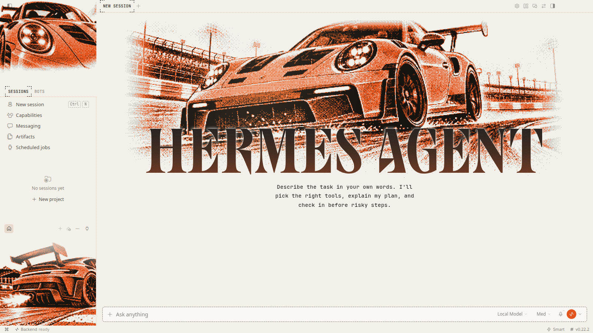
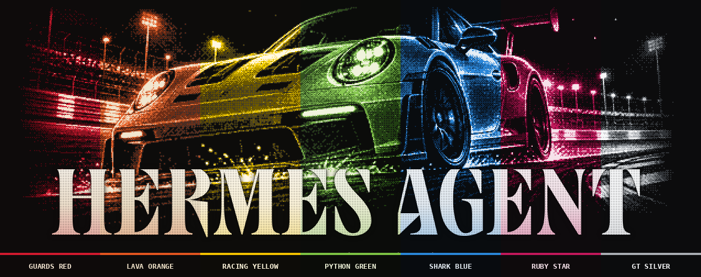
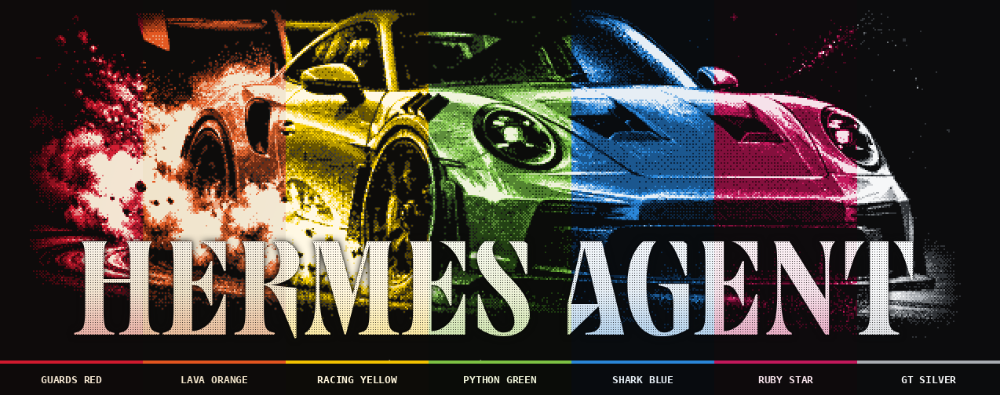
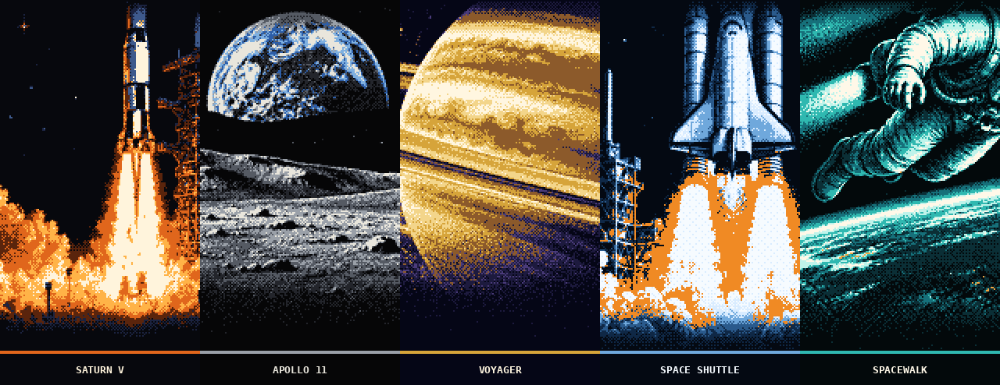
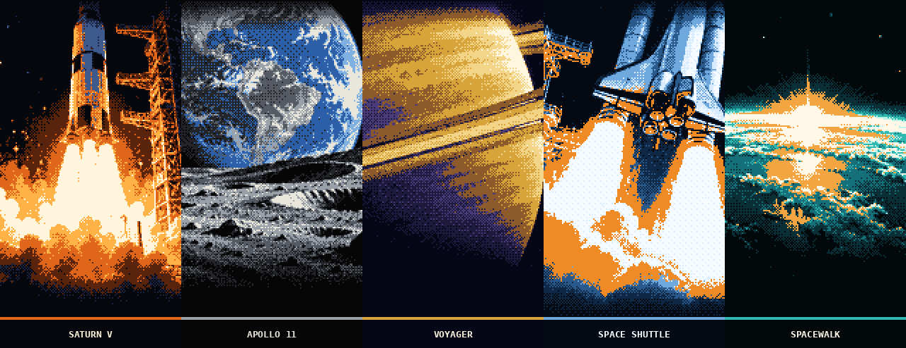

<div align="center">

# Hermes Desktop Skins

**Pixel-art wallpaper themes for Hermes Desktop.**

Dithered pixel art for the desktop app: a wide hero above the wordmark, two sidebar panels and a faint backdrop behind your conversations.
Every theme has a dark and a light edition and a touch of animation. Install once and switch from the theme picker.

<sub>FOR <a href="https://github.com/NousResearch/hermes-agent">HERMES DESKTOP</a> &nbsp;·&nbsp; 4 COLLECTIONS &nbsp;·&nbsp; 24 THEMES</sub>

<br /><br />

| Dark mode | Light mode |
|:---:|:---:|
|  |  |

</div>

## Install

You need Hermes Desktop 0.22.2 or later.

1. In Hermes Desktop, open **Capabilities → Plugins**, click **Install from Git**, paste `https://github.com/AbrahamCete/hermes-desktop-skins` and install. From a terminal: `hermes plugins install AbrahamCete/hermes-desktop-skins`.
2. Flip the plugin's **Desktop** switch on. Desktop plugins installed from a package start turned off.
3. Pick a theme in the theme picker. Hermes' light/dark switch picks the matching edition.

Animations (a light sweep over the cars, twinkling stars and drifting astronauts in space) stop when your system asks for reduced motion.

## Collections

Themes come in collections: one subject, several looks. Click a banner to see every theme of a collection applied to Hermes Desktop.

<!-- catalog:start -->
### [GT3 RS](themes/gt3rs) &nbsp;<sub>7 themes</sub>

<a href="themes/gt3rs"></a>

Seven factory colours of the 992 GT3 RS. Same car, different paint. **[Browse the collection →](themes/gt3rs)**

<sub>`gt3rs-guards` `gt3rs-lava` `gt3rs-yellow` `gt3rs-python` `gt3rs-shark` `gt3rs-ruby` `gt3rs-silver`</sub>

### [GT3 RS Drift](themes/drift) &nbsp;<sub>7 themes</sub>

<a href="themes/drift"></a>

The 992 GT3 RS sideways in a cloud of tyre smoke, in seven factory colours. **[Browse the collection →](themes/drift)**

<sub>`drift-guards` `drift-lava` `drift-yellow` `drift-python` `drift-shark` `drift-ruby` `drift-silver`</sub>

### [Moonshot](themes/moonshot) &nbsp;<sub>5 themes</sub>

<a href="themes/moonshot"></a>

The space age as a 1960s print: the same five missions, drawn again. **[Browse the collection →](themes/moonshot)**

<sub>`moonshot-saturn` `moonshot-apollo` `moonshot-voyager` `moonshot-shuttle` `moonshot-eva`</sub>

### [Space Race](themes/space) &nbsp;<sub>5 themes</sub>

<a href="themes/space"></a>

Five moments of the space age, from the Saturn V to the spacewalk. **[Browse the collection →](themes/space)**

<sub>`space-saturn` `space-apollo` `space-voyager` `space-shuttle` `space-eva`</sub>

<details>
<summary><b>Every theme</b> (24)</summary>

| Collection | Theme | Id | Files |
|---|---|---|---|
| [GT3 RS](themes/gt3rs) | Guards Red | `gt3rs-guards` | [dark](themes/gt3rs/guards/screenshot.png) · [light](themes/gt3rs/guards/screenshot-light.png) · [art](themes/gt3rs/guards/art) |
| [GT3 RS](themes/gt3rs) | Lava Orange | `gt3rs-lava` | [dark](themes/gt3rs/lava/screenshot.png) · [light](themes/gt3rs/lava/screenshot-light.png) · [art](themes/gt3rs/lava/art) |
| [GT3 RS](themes/gt3rs) | Racing Yellow | `gt3rs-yellow` | [dark](themes/gt3rs/yellow/screenshot.png) · [light](themes/gt3rs/yellow/screenshot-light.png) · [art](themes/gt3rs/yellow/art) |
| [GT3 RS](themes/gt3rs) | Python Green | `gt3rs-python` | [dark](themes/gt3rs/python/screenshot.png) · [light](themes/gt3rs/python/screenshot-light.png) · [art](themes/gt3rs/python/art) |
| [GT3 RS](themes/gt3rs) | Shark Blue | `gt3rs-shark` | [dark](themes/gt3rs/shark/screenshot.png) · [light](themes/gt3rs/shark/screenshot-light.png) · [art](themes/gt3rs/shark/art) |
| [GT3 RS](themes/gt3rs) | Ruby Star | `gt3rs-ruby` | [dark](themes/gt3rs/ruby/screenshot.png) · [light](themes/gt3rs/ruby/screenshot-light.png) · [art](themes/gt3rs/ruby/art) |
| [GT3 RS](themes/gt3rs) | GT Silver | `gt3rs-silver` | [dark](themes/gt3rs/silver/screenshot.png) · [light](themes/gt3rs/silver/screenshot-light.png) · [art](themes/gt3rs/silver/art) |
| [GT3 RS Drift](themes/drift) | Guards Red | `drift-guards` | [dark](themes/drift/guards/screenshot.png) · [light](themes/drift/guards/screenshot-light.png) · [art](themes/drift/guards/art) |
| [GT3 RS Drift](themes/drift) | Lava Orange | `drift-lava` | [dark](themes/drift/lava/screenshot.png) · [light](themes/drift/lava/screenshot-light.png) · [art](themes/drift/lava/art) |
| [GT3 RS Drift](themes/drift) | Racing Yellow | `drift-yellow` | [dark](themes/drift/yellow/screenshot.png) · [light](themes/drift/yellow/screenshot-light.png) · [art](themes/drift/yellow/art) |
| [GT3 RS Drift](themes/drift) | Python Green | `drift-python` | [dark](themes/drift/python/screenshot.png) · [light](themes/drift/python/screenshot-light.png) · [art](themes/drift/python/art) |
| [GT3 RS Drift](themes/drift) | Shark Blue | `drift-shark` | [dark](themes/drift/shark/screenshot.png) · [light](themes/drift/shark/screenshot-light.png) · [art](themes/drift/shark/art) |
| [GT3 RS Drift](themes/drift) | Ruby Star | `drift-ruby` | [dark](themes/drift/ruby/screenshot.png) · [light](themes/drift/ruby/screenshot-light.png) · [art](themes/drift/ruby/art) |
| [GT3 RS Drift](themes/drift) | GT Silver | `drift-silver` | [dark](themes/drift/silver/screenshot.png) · [light](themes/drift/silver/screenshot-light.png) · [art](themes/drift/silver/art) |
| [Moonshot](themes/moonshot) | Saturn V | `moonshot-saturn` | [dark](themes/moonshot/saturn/screenshot.png) · [light](themes/moonshot/saturn/screenshot-light.png) · [art](themes/moonshot/saturn/art) |
| [Moonshot](themes/moonshot) | Apollo 11 | `moonshot-apollo` | [dark](themes/moonshot/apollo/screenshot.png) · [light](themes/moonshot/apollo/screenshot-light.png) · [art](themes/moonshot/apollo/art) |
| [Moonshot](themes/moonshot) | Voyager | `moonshot-voyager` | [dark](themes/moonshot/voyager/screenshot.png) · [light](themes/moonshot/voyager/screenshot-light.png) · [art](themes/moonshot/voyager/art) |
| [Moonshot](themes/moonshot) | Space Shuttle | `moonshot-shuttle` | [dark](themes/moonshot/shuttle/screenshot.png) · [light](themes/moonshot/shuttle/screenshot-light.png) · [art](themes/moonshot/shuttle/art) |
| [Moonshot](themes/moonshot) | Spacewalk | `moonshot-eva` | [dark](themes/moonshot/eva/screenshot.png) · [light](themes/moonshot/eva/screenshot-light.png) · [art](themes/moonshot/eva/art) |
| [Space Race](themes/space) | Saturn V | `space-saturn` | [dark](themes/space/saturn/screenshot.png) · [light](themes/space/saturn/screenshot-light.png) · [art](themes/space/saturn/art) |
| [Space Race](themes/space) | Apollo 11 | `space-apollo` | [dark](themes/space/apollo/screenshot.png) · [light](themes/space/apollo/screenshot-light.png) · [art](themes/space/apollo/art) |
| [Space Race](themes/space) | Voyager | `space-voyager` | [dark](themes/space/voyager/screenshot.png) · [light](themes/space/voyager/screenshot-light.png) · [art](themes/space/voyager/art) |
| [Space Race](themes/space) | Space Shuttle | `space-shuttle` | [dark](themes/space/shuttle/screenshot.png) · [light](themes/space/shuttle/screenshot-light.png) · [art](themes/space/shuttle/art) |
| [Space Race](themes/space) | Spacewalk | `space-eva` | [dark](themes/space/eva/screenshot.png) · [light](themes/space/eva/screenshot-light.png) · [art](themes/space/eva/art) |

</details>
<!-- catalog:end -->

## Download the art

Themes are grouped by collection under [`themes/`](themes), one folder per theme:

```text
themes/
└── gt3rs/                  a collection
    ├── README.md             its gallery
    ├── banner.png            every theme side by side
    ├── art-sheet.png         all its pixel art
    ├── collection.json       title, description, order
    └── lava/                 a theme (id gt3rs-lava)
        ├── art/              the pixel images at native size, transparent background
        │   ├── hero.png        600×225 · above the wordmark
        │   ├── top.png         160×120 · top of the sidebar
        │   ├── bottom.png      160×133 · bottom of the sidebar
        │   └── *-light.png     the same three for the light edition
        ├── raw/              the full-resolution source images (colour variants
        │                     reuse another theme's via "source" in theme.json)
        ├── screenshot.png    the theme applied to Hermes Desktop (dark mode)
        ├── screenshot-light.png                      (light mode)
        ├── preview.png       a quick layout mock
        ├── prompts.txt       the image prompts, dark and light
        └── theme.json        palettes, colours, dither settings and animation
```

The art is meant to be shown at 2× with nearest-neighbour scaling, which is how the app renders it.

## How the themes are made

```text
prompts.txt ──► raw/*.png ──► art/*.png ──► desktop/plugin.js
        generate.py      pixelate.py      build.py
        (Codex image     (crop, resize,   (embeds every theme
         generation)      4-colour         into one plugin)
                          ordered dither)
```

| Tool | What it does |
|---|---|
| `tools/generate.py <theme-dir>…` | Renders each theme's `prompts.txt` into `raw/` with Codex image generation, in parallel |
| `tools/pixelate.py <theme-dir>` | Crops and downsamples the raw images to each slot and dithers them onto the theme ramp |
| `tools/recolor.py <base-dir> <new-dir> <label> <body> <shadow> <highlight> [bg]` | Creates a colour variant that reuses the base theme's raw art |
| `tools/build.py` | Bundles every theme into `plugin.yaml` + `desktop/plugin.js` |
| `tools/screenshot.mjs [--mode light] [theme ids…]` | Takes a real Hermes Desktop screenshot of each theme from an isolated, empty profile |
| `tools/preview.py <theme-dir>` | Renders a quick layout mock without launching the app |
| `tools/sheet.py <collection-dir> <out.png>` | Renders the side-by-side art sheet of a collection |
| `tools/catalog.py` | Builds every collection's banner, art sheet and gallery page, and the collection index in this README |

Requirements: Python 3 with Pillow, and Node 22 for the screenshots.

## License

[MIT](LICENSE). The layout CSS is adapted from [Hermes Pantheon](https://github.com/Adolanium/hermes-pantheon) (MIT).

> **Community project**
>
> Hermes Desktop Skins is an independent fan project. It is not affiliated with, endorsed by, or sponsored by Nous Research, the Hermes Agent project, or Porsche AG. Hermes, Hermes Agent, Porsche, 911 and GT3 RS are names and trademarks of their respective owners. The artwork is original fan art and contains no manufacturer logos.
