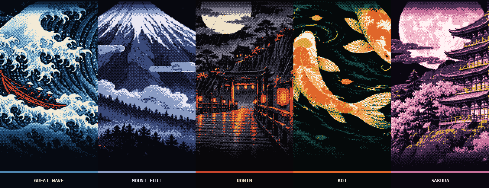

<div align="center">

# Hermes Desktop Skins

**Pixel-art wallpaper themes for Hermes Desktop.**

Dithered pixel art for the desktop app: a wide hero above the wordmark, two sidebar panels and a faint backdrop behind your conversations.
Every theme has a dark and a light edition and a touch of animation. Install once and switch from the theme picker.

<sub>FOR <a href="https://github.com/NousResearch/hermes-agent">HERMES DESKTOP</a> &nbsp;·&nbsp; 5 COLLECTIONS &nbsp;·&nbsp; 29 THEMES</sub>

<br /><br />

| Dark mode | Light mode |
|:---:|:---:|
|  |  |

</div>

## Install

You need **Hermes Desktop 0.22.2 or later**.

### 1. Add the plugin

**From the app** (no terminal needed): open **Capabilities → Plugins**, click **Install from Git**, paste this address, click **Review repository** and install:

```text
https://github.com/AbrahamCete/hermes-desktop-skins
```

**From a terminal:**

```sh
hermes plugins install AbrahamCete/hermes-desktop-skins
```

### 2. Turn it on

In **Capabilities → Plugins**, find **hermes-desktop-skins** and flip its **Desktop** switch on. Desktop plugins installed from a package start turned off, and this is the step people miss.

### 3. Pick a theme

Open **Settings → Appearance** and choose a theme, for example **GT3 RS Lava Orange** or **Moonshot · Spacewalk**. Switch between **light** and **dark** there too: every theme has both editions of its scene.

Animations (a light sweep over the cars, twinkling stars and drifting astronauts in space) stop when your system asks for reduced motion.

### Update or remove

```sh
hermes plugins update hermes-desktop-skins   # get new themes
hermes plugins remove hermes-desktop-skins   # uninstall
```

Restart Hermes Desktop after updating to load the new themes.

## Collections

Themes are grouped by subject, and each subject has collections: one scene in several looks. Click a banner to see every theme of a collection applied to Hermes Desktop.

<!-- catalog:start -->
### [Edo](themes/edo)

Japan's Edo period as woodblock prints: night scenes in dark mode, washi paper in light mode.

#### [Floating World](themes/edo/floating-world) &nbsp;<sub>5 themes</sub>

<a href="themes/edo/floating-world"></a>

Ukiyo-e in pixels: the great wave, Fuji, a ronin in the rain, koi and sakura. **[Browse the collection →](themes/edo/floating-world)**

<sub>`edo-wave` `edo-fuji` `edo-ronin` `edo-koi` `edo-sakura`</sub>

### [GT3 RS](themes/gt3rs)

The GT3 RS in seven factory colours: on a night track and sideways in a drift.

#### [GT3 RS](themes/gt3rs/track) &nbsp;<sub>7 themes</sub>

<a href="themes/gt3rs/track"></a>

Seven factory colours of the 992 GT3 RS. Same car, different paint. **[Browse the collection →](themes/gt3rs/track)**

<sub>`gt3rs-guards` `gt3rs-lava` `gt3rs-yellow` `gt3rs-python` `gt3rs-shark` `gt3rs-ruby` `gt3rs-silver`</sub>

#### [GT3 RS Drift](themes/gt3rs/drift) &nbsp;<sub>7 themes</sub>

<a href="themes/gt3rs/drift"></a>

The 992 GT3 RS sideways in a cloud of tyre smoke, in seven factory colours. **[Browse the collection →](themes/gt3rs/drift)**

<sub>`drift-guards` `drift-lava` `drift-yellow` `drift-python` `drift-shark` `drift-ruby` `drift-silver`</sub>

### [Space](themes/space)

The space age in pixels: epic launches and missions, and the same five missions as a 1960s print.

#### [Moonshot](themes/space/moonshot) &nbsp;<sub>5 themes</sub>

<a href="themes/space/moonshot"></a>

The space age as a 1960s print: the same five missions, drawn again. **[Browse the collection →](themes/space/moonshot)**

<sub>`moonshot-saturn` `moonshot-apollo` `moonshot-voyager` `moonshot-shuttle` `moonshot-eva`</sub>

#### [Space Race](themes/space/race) &nbsp;<sub>5 themes</sub>

<a href="themes/space/race"></a>

Five moments of the space age, from the Saturn V to the spacewalk. **[Browse the collection →](themes/space/race)**

<sub>`space-saturn` `space-apollo` `space-voyager` `space-shuttle` `space-eva`</sub>

<details>
<summary><b>Every theme</b> (29)</summary>

| Collection | Theme | Id | Screenshots |
|---|---|---|---|
| [Floating World](themes/edo/floating-world) | Great Wave | `edo-wave` | [dark](themes/edo/floating-world/wave/screenshot.png) · [light](themes/edo/floating-world/wave/screenshot-light.png) |
| [Floating World](themes/edo/floating-world) | Mount Fuji | `edo-fuji` | [dark](themes/edo/floating-world/fuji/screenshot.png) · [light](themes/edo/floating-world/fuji/screenshot-light.png) |
| [Floating World](themes/edo/floating-world) | Ronin | `edo-ronin` | [dark](themes/edo/floating-world/ronin/screenshot.png) · [light](themes/edo/floating-world/ronin/screenshot-light.png) |
| [Floating World](themes/edo/floating-world) | Koi | `edo-koi` | [dark](themes/edo/floating-world/koi/screenshot.png) · [light](themes/edo/floating-world/koi/screenshot-light.png) |
| [Floating World](themes/edo/floating-world) | Sakura | `edo-sakura` | [dark](themes/edo/floating-world/sakura/screenshot.png) · [light](themes/edo/floating-world/sakura/screenshot-light.png) |
| [GT3 RS](themes/gt3rs/track) | Guards Red | `gt3rs-guards` | [dark](themes/gt3rs/track/guards/screenshot.png) · [light](themes/gt3rs/track/guards/screenshot-light.png) |
| [GT3 RS](themes/gt3rs/track) | Lava Orange | `gt3rs-lava` | [dark](themes/gt3rs/track/lava/screenshot.png) · [light](themes/gt3rs/track/lava/screenshot-light.png) |
| [GT3 RS](themes/gt3rs/track) | Racing Yellow | `gt3rs-yellow` | [dark](themes/gt3rs/track/yellow/screenshot.png) · [light](themes/gt3rs/track/yellow/screenshot-light.png) |
| [GT3 RS](themes/gt3rs/track) | Python Green | `gt3rs-python` | [dark](themes/gt3rs/track/python/screenshot.png) · [light](themes/gt3rs/track/python/screenshot-light.png) |
| [GT3 RS](themes/gt3rs/track) | Shark Blue | `gt3rs-shark` | [dark](themes/gt3rs/track/shark/screenshot.png) · [light](themes/gt3rs/track/shark/screenshot-light.png) |
| [GT3 RS](themes/gt3rs/track) | Ruby Star | `gt3rs-ruby` | [dark](themes/gt3rs/track/ruby/screenshot.png) · [light](themes/gt3rs/track/ruby/screenshot-light.png) |
| [GT3 RS](themes/gt3rs/track) | GT Silver | `gt3rs-silver` | [dark](themes/gt3rs/track/silver/screenshot.png) · [light](themes/gt3rs/track/silver/screenshot-light.png) |
| [GT3 RS Drift](themes/gt3rs/drift) | Guards Red | `drift-guards` | [dark](themes/gt3rs/drift/guards/screenshot.png) · [light](themes/gt3rs/drift/guards/screenshot-light.png) |
| [GT3 RS Drift](themes/gt3rs/drift) | Lava Orange | `drift-lava` | [dark](themes/gt3rs/drift/lava/screenshot.png) · [light](themes/gt3rs/drift/lava/screenshot-light.png) |
| [GT3 RS Drift](themes/gt3rs/drift) | Racing Yellow | `drift-yellow` | [dark](themes/gt3rs/drift/yellow/screenshot.png) · [light](themes/gt3rs/drift/yellow/screenshot-light.png) |
| [GT3 RS Drift](themes/gt3rs/drift) | Python Green | `drift-python` | [dark](themes/gt3rs/drift/python/screenshot.png) · [light](themes/gt3rs/drift/python/screenshot-light.png) |
| [GT3 RS Drift](themes/gt3rs/drift) | Shark Blue | `drift-shark` | [dark](themes/gt3rs/drift/shark/screenshot.png) · [light](themes/gt3rs/drift/shark/screenshot-light.png) |
| [GT3 RS Drift](themes/gt3rs/drift) | Ruby Star | `drift-ruby` | [dark](themes/gt3rs/drift/ruby/screenshot.png) · [light](themes/gt3rs/drift/ruby/screenshot-light.png) |
| [GT3 RS Drift](themes/gt3rs/drift) | GT Silver | `drift-silver` | [dark](themes/gt3rs/drift/silver/screenshot.png) · [light](themes/gt3rs/drift/silver/screenshot-light.png) |
| [Moonshot](themes/space/moonshot) | Saturn V | `moonshot-saturn` | [dark](themes/space/moonshot/saturn/screenshot.png) · [light](themes/space/moonshot/saturn/screenshot-light.png) |
| [Moonshot](themes/space/moonshot) | Apollo 11 | `moonshot-apollo` | [dark](themes/space/moonshot/apollo/screenshot.png) · [light](themes/space/moonshot/apollo/screenshot-light.png) |
| [Moonshot](themes/space/moonshot) | Voyager | `moonshot-voyager` | [dark](themes/space/moonshot/voyager/screenshot.png) · [light](themes/space/moonshot/voyager/screenshot-light.png) |
| [Moonshot](themes/space/moonshot) | Space Shuttle | `moonshot-shuttle` | [dark](themes/space/moonshot/shuttle/screenshot.png) · [light](themes/space/moonshot/shuttle/screenshot-light.png) |
| [Moonshot](themes/space/moonshot) | Spacewalk | `moonshot-eva` | [dark](themes/space/moonshot/eva/screenshot.png) · [light](themes/space/moonshot/eva/screenshot-light.png) |
| [Space Race](themes/space/race) | Saturn V | `space-saturn` | [dark](themes/space/race/saturn/screenshot.png) · [light](themes/space/race/saturn/screenshot-light.png) |
| [Space Race](themes/space/race) | Apollo 11 | `space-apollo` | [dark](themes/space/race/apollo/screenshot.png) · [light](themes/space/race/apollo/screenshot-light.png) |
| [Space Race](themes/space/race) | Voyager | `space-voyager` | [dark](themes/space/race/voyager/screenshot.png) · [light](themes/space/race/voyager/screenshot-light.png) |
| [Space Race](themes/space/race) | Space Shuttle | `space-shuttle` | [dark](themes/space/race/shuttle/screenshot.png) · [light](themes/space/race/shuttle/screenshot-light.png) |
| [Space Race](themes/space/race) | Spacewalk | `space-eva` | [dark](themes/space/race/eva/screenshot.png) · [light](themes/space/race/eva/screenshot-light.png) |

</details>
<!-- catalog:end -->

## License

[MIT](LICENSE).

> **Community project**
>
> Hermes Desktop Skins is a free, independent community project, made for anyone to use, share and enjoy. It is not affiliated with, endorsed by, or sponsored by Nous Research or the Hermes Agent project. Hermes and Hermes Agent are names and trademarks of their respective owners, as are any other names mentioned here. The artwork is original and contains no brand logos.
