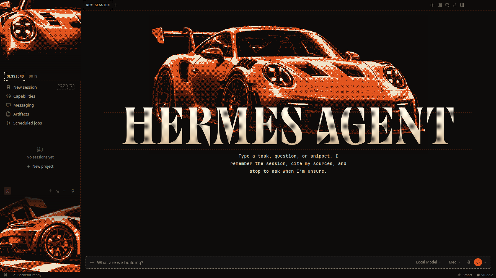
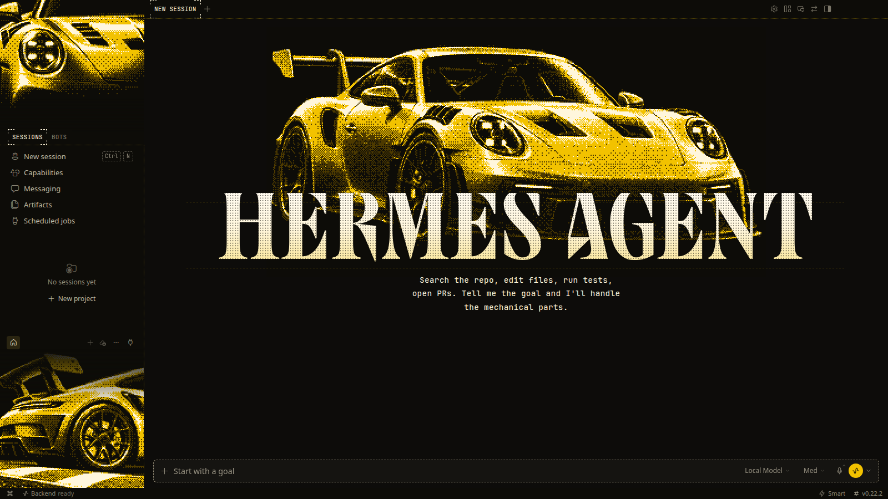
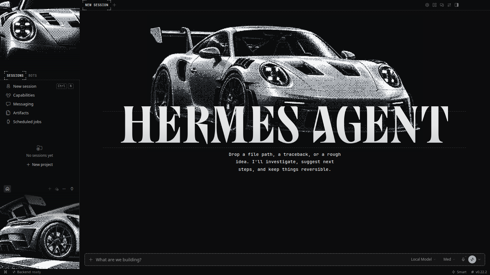
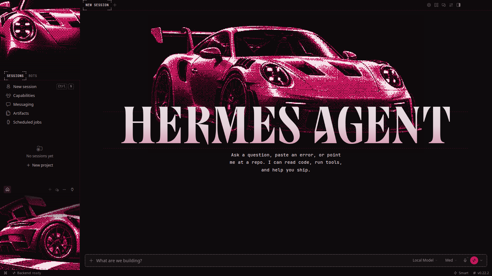

<div align="center">

# Hermes Desktop Skins

**Pixel-art wallpaper themes for Hermes Desktop.**

Dithered, hand-tuned pixel art for the three art slots of the desktop app: the hero above the wordmark and the two sidebar panels.
Install once and switch themes from the theme picker.

<sub>FOR <a href="https://github.com/NousResearch/hermes-agent">HERMES DESKTOP</a> &nbsp;·&nbsp; COMMUNITY THEMES &nbsp;·&nbsp; 7 THEMES</sub>

<br /><br />



</div>

## Install

You need Hermes Desktop 0.22.2 or later.

1. In Hermes Desktop, open **Capabilities → Plugins**, click **Install from Git**, paste `https://github.com/AbrahamCete/hermes-desktop-skins` and install. From a terminal: `hermes plugins install AbrahamCete/hermes-desktop-skins`.
2. Flip the plugin's **Desktop** switch on. Desktop plugins installed from a package start turned off.
3. Pick a theme in the theme picker.

## Themes

### GT3 RS

Seven factory colours of the 992 GT3 RS, one theme each. Same art, different paint.

| | |
|:---:|:---:|
|  **Lava Orange** · `gt3rs-lava` |  **Shark Blue** · `gt3rs-shark` |
|  **Python Green** · `gt3rs-python` |  **Guards Red** · `gt3rs-guards` |
|  **Racing Yellow** · `gt3rs-yellow` |  **GT Silver** · `gt3rs-silver` |
|  **Ruby Star** · `gt3rs-ruby` | |

<details>
<summary>All the art, side by side</summary>

<br />


</details>

## Download the art

Every theme lives in its own folder under [`themes/`](themes):

```text
themes/gt3rs-lava/
├── art/            the three pixel images, at native size
│   ├── hero.png      450×225 · above the wordmark
│   ├── top.png       160×120 · top of the sidebar
│   └── bottom.png    160×133 · bottom of the sidebar
├── raw/            the full-resolution source images
├── screenshot.png  the theme applied to Hermes Desktop
├── preview.png     a quick layout mock
└── theme.json      palette, colours and dither settings
```

The art is meant to be shown at 2× with nearest-neighbour scaling, which is how the app renders it.

## How the themes are made

```text
prompt ──► raw/*.png ──► tools/pixelate.py ──► art/*.png ──► tools/build.py ──► desktop/plugin.js
            (image model)   crop, resize, 4-colour            embeds every theme
                            ordered dither                    into one plugin
```

| Tool | What it does |
|---|---|
| `tools/pixelate.py <theme-dir>` | Crops and downsamples the raw images to each slot and dithers them onto the theme ramp |
| `tools/recolor.py <base> <name> <label> <body> <shadow> <highlight> [bg]` | Creates a colour variant that reuses the base theme's raw art |
| `tools/build.py` | Bundles every theme into `plugin.yaml` + `desktop/plugin.js` |
| `tools/screenshot.mjs [theme ids…]` | Takes a real Hermes Desktop screenshot of each theme from an isolated, empty profile |
| `tools/preview.py <theme-dir>` | Renders a quick layout mock without launching the app |
| `tools/sheet.py <prefix> <out.png>` | Renders the side-by-side art sheet for a family of themes |

Requirements: Python 3 with Pillow, and Node 22 for the screenshots.

## License

[MIT](LICENSE). The layout CSS is adapted from [Hermes Pantheon](https://github.com/Adolanium/hermes-pantheon) (MIT).

> **Community project**
>
> Hermes Desktop Skins is an independent fan project. It is not affiliated with, endorsed by, or sponsored by Nous Research, the Hermes Agent project, or Porsche AG. Hermes, Hermes Agent, Porsche, 911 and GT3 RS are names and trademarks of their respective owners. The artwork is original fan art and contains no manufacturer logos.
