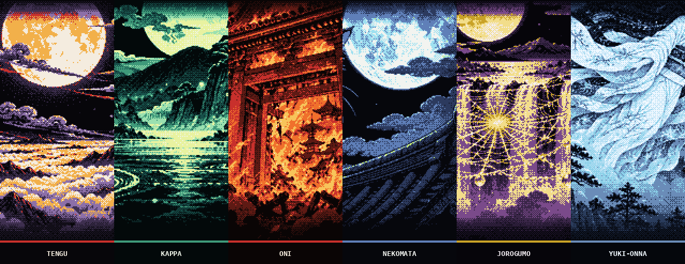

# Edo

**Japan's Edo period as woodblock prints, from the great wave to yokai and the gods of myth: night scenes in dark mode, washi paper in light mode.**

4 COLLECTIONS &nbsp;·&nbsp; 22 THEMES &nbsp;·&nbsp; <a href="../../README.md#install">INSTALL</a>

## [Floating World](floating-world) &nbsp;5 themes

Ukiyo-e in pixels: the great wave, Fuji, a ronin in the rain, koi and sakura. **[Browse the collection →](floating-world)**

`edo-wave` `edo-fuji` `edo-ronin` `edo-koi` `edo-sakura`

## [Kami & Beasts](kami) &nbsp;6 themes

Thunder and sun gods, the phoenix, the eight-headed serpent, the kirin and the dream eater. **[Browse the collection →](kami)**

`edo-raijin` `edo-amaterasu` `edo-hoo` `edo-orochi` `edo-kirin` `edo-baku`

## [Shrines & Spirits](spirits) &nbsp;5 themes

Torii in the sea, a storm dragon, fox spirits, winter cranes and a bamboo night walk. **[Browse the collection →](spirits)**

`edo-torii` `edo-dragon` `edo-kitsune` `edo-crane` `edo-bamboo`

## [Yokai Night Parade](yokai) &nbsp;6 themes

Goblins, river imps, demons and ghosts of Japanese folklore, glowing through the night. **[Browse the collection →](yokai)**

`edo-tengu` `edo-kappa` `edo-oni` `edo-nekomata` `edo-jorogumo` `edo-yukionna`

<b>Every theme</b> (22)

| Collection | Theme | Id | Screenshots |
|---|---|---|---|
| [Floating World](floating-world) | Great Wave | `edo-wave` | [dark](floating-world/wave/screenshot.png) · [light](floating-world/wave/screenshot-light.png) |
| [Floating World](floating-world) | Mount Fuji | `edo-fuji` | [dark](floating-world/fuji/screenshot.png) · [light](floating-world/fuji/screenshot-light.png) |
| [Floating World](floating-world) | Ronin | `edo-ronin` | [dark](floating-world/ronin/screenshot.png) · [light](floating-world/ronin/screenshot-light.png) |
| [Floating World](floating-world) | Koi | `edo-koi` | [dark](floating-world/koi/screenshot.png) · [light](floating-world/koi/screenshot-light.png) |
| [Floating World](floating-world) | Sakura | `edo-sakura` | [dark](floating-world/sakura/screenshot.png) · [light](floating-world/sakura/screenshot-light.png) |
| [Kami & Beasts](kami) | Raijin & Fujin | `edo-raijin` | [dark](kami/raijin/screenshot.png) · [light](kami/raijin/screenshot-light.png) |
| [Kami & Beasts](kami) | Amaterasu | `edo-amaterasu` | [dark](kami/amaterasu/screenshot.png) · [light](kami/amaterasu/screenshot-light.png) |
| [Kami & Beasts](kami) | Hoo Phoenix | `edo-hoo` | [dark](kami/hoo/screenshot.png) · [light](kami/hoo/screenshot-light.png) |
| [Kami & Beasts](kami) | Orochi | `edo-orochi` | [dark](kami/orochi/screenshot.png) · [light](kami/orochi/screenshot-light.png) |
| [Kami & Beasts](kami) | Kirin | `edo-kirin` | [dark](kami/kirin/screenshot.png) · [light](kami/kirin/screenshot-light.png) |
| [Kami & Beasts](kami) | Baku | `edo-baku` | [dark](kami/baku/screenshot.png) · [light](kami/baku/screenshot-light.png) |
| [Shrines & Spirits](spirits) | Torii | `edo-torii` | [dark](spirits/torii/screenshot.png) · [light](spirits/torii/screenshot-light.png) |
| [Shrines & Spirits](spirits) | Dragon | `edo-dragon` | [dark](spirits/dragon/screenshot.png) · [light](spirits/dragon/screenshot-light.png) |
| [Shrines & Spirits](spirits) | Kitsune | `edo-kitsune` | [dark](spirits/kitsune/screenshot.png) · [light](spirits/kitsune/screenshot-light.png) |
| [Shrines & Spirits](spirits) | Crane | `edo-crane` | [dark](spirits/crane/screenshot.png) · [light](spirits/crane/screenshot-light.png) |
| [Shrines & Spirits](spirits) | Bamboo | `edo-bamboo` | [dark](spirits/bamboo/screenshot.png) · [light](spirits/bamboo/screenshot-light.png) |
| [Yokai Night Parade](yokai) | Tengu | `edo-tengu` | [dark](yokai/tengu/screenshot.png) · [light](yokai/tengu/screenshot-light.png) |
| [Yokai Night Parade](yokai) | Kappa | `edo-kappa` | [dark](yokai/kappa/screenshot.png) · [light](yokai/kappa/screenshot-light.png) |
| [Yokai Night Parade](yokai) | Oni | `edo-oni` | [dark](yokai/oni/screenshot.png) · [light](yokai/oni/screenshot-light.png) |
| [Yokai Night Parade](yokai) | Nekomata | `edo-nekomata` | [dark](yokai/nekomata/screenshot.png) · [light](yokai/nekomata/screenshot-light.png) |
| [Yokai Night Parade](yokai) | Jorogumo | `edo-jorogumo` | [dark](yokai/jorogumo/screenshot.png) · [light](yokai/jorogumo/screenshot-light.png) |
| [Yokai Night Parade](yokai) | Yuki-onna | `edo-yukionna` | [dark](yokai/yukionna/screenshot.png) · [light](yokai/yukionna/screenshot-light.png) |

