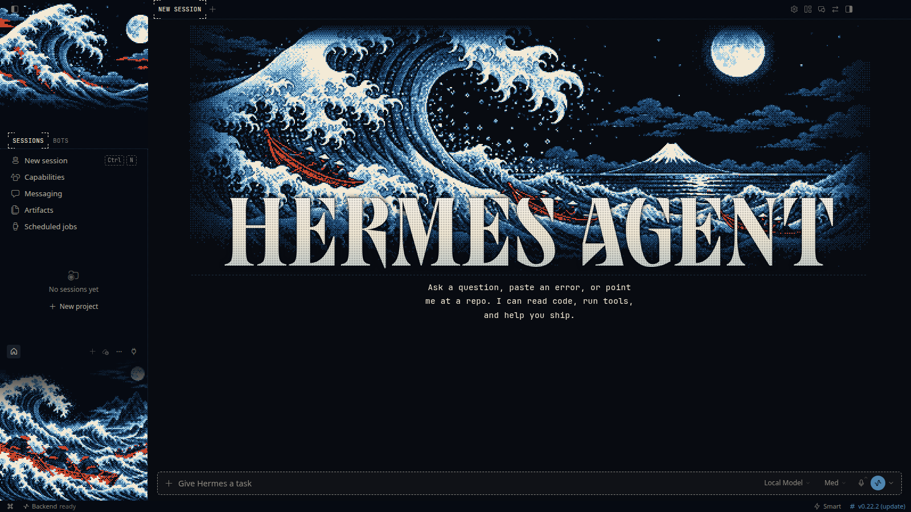
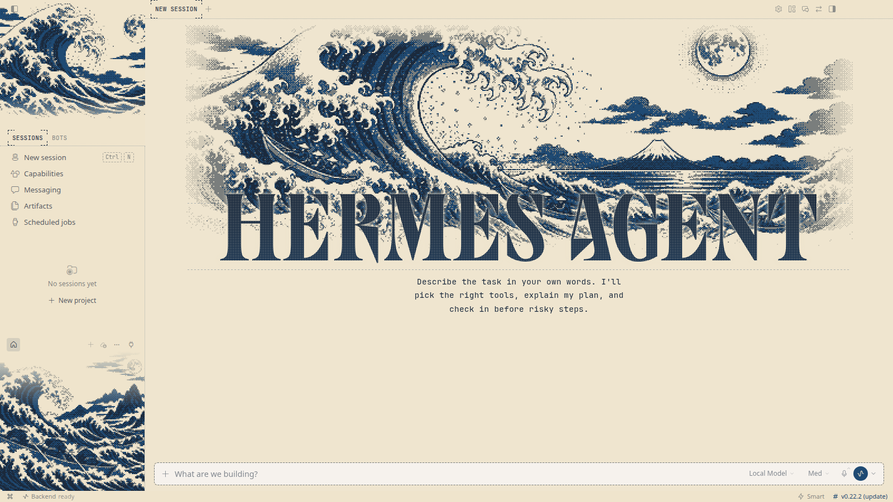
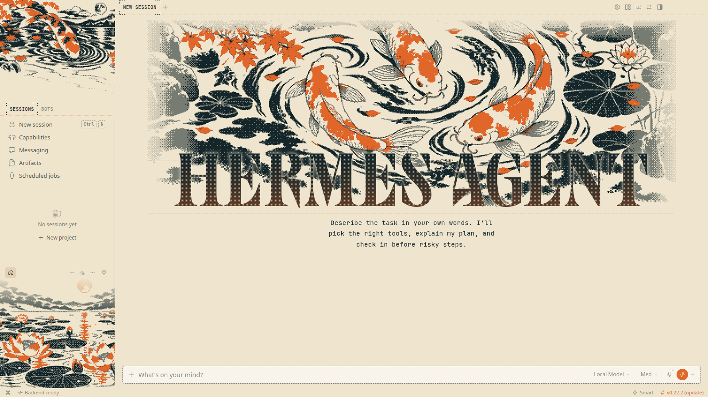
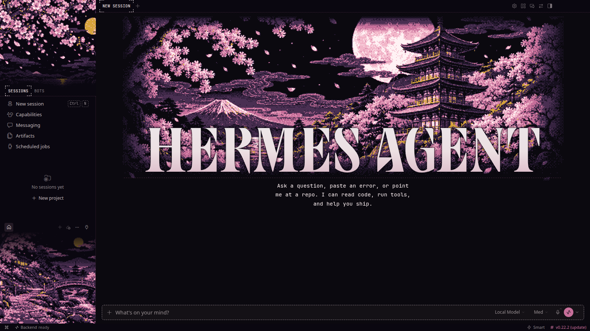

# Floating World

**Ukiyo-e in pixels: the great wave, Fuji, a ronin in the rain, koi and sakura.**

5 THEMES &nbsp;·&nbsp; <a href="../../../README.md#install">INSTALL</a> &nbsp;·&nbsp; <a href="../../../README.md#collections">ALL COLLECTIONS</a>

  

## Great Wave

`edo-wave` · The great wave breaking under a full moon

| Dark mode | Light mode |
|:---:|:---:|
|  |  |

## Mount Fuji

`edo-fuji` · Fuji above the clouds at dusk

| Dark mode | Light mode |
|:---:|:---:|
|  |  |

## Ronin

`edo-ronin` · A lone samurai crossing the bridge in the rain

| Dark mode | Light mode |
|:---:|:---:|
|  |  |

## Koi

`edo-koi` · Koi circling in a dark pond

| Dark mode | Light mode |
|:---:|:---:|
|  |  |

## Sakura

`edo-sakura` · Cherry blossoms around the pagoda

| Dark mode | Light mode |
|:---:|:---:|
|  |  |
