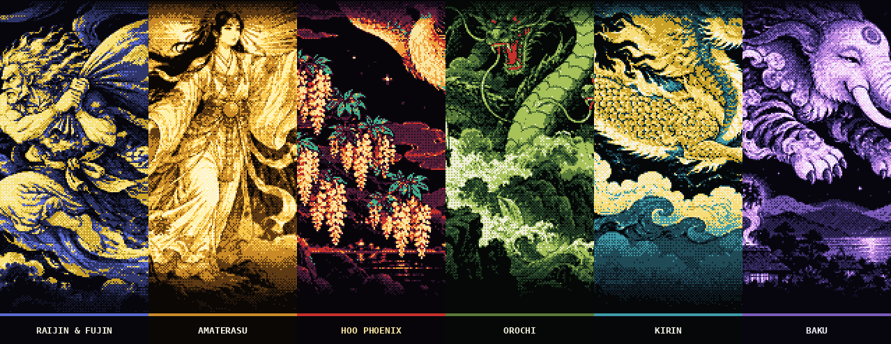
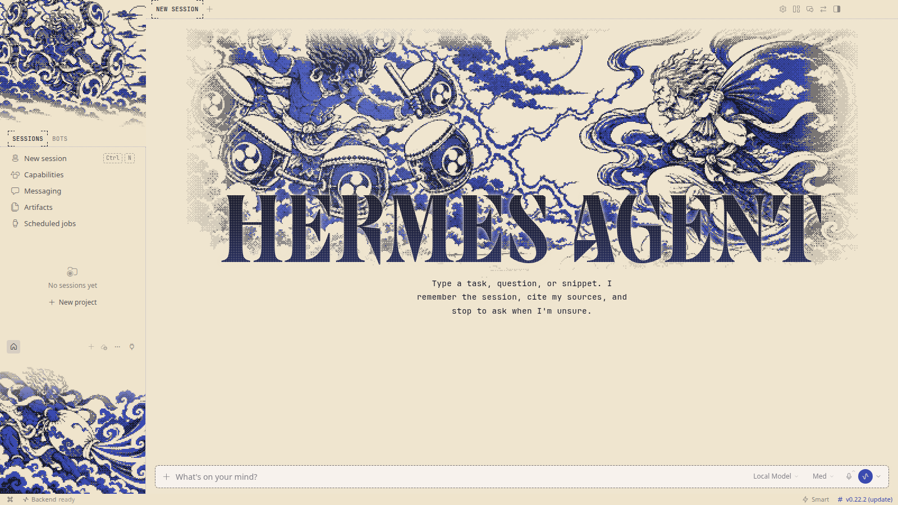
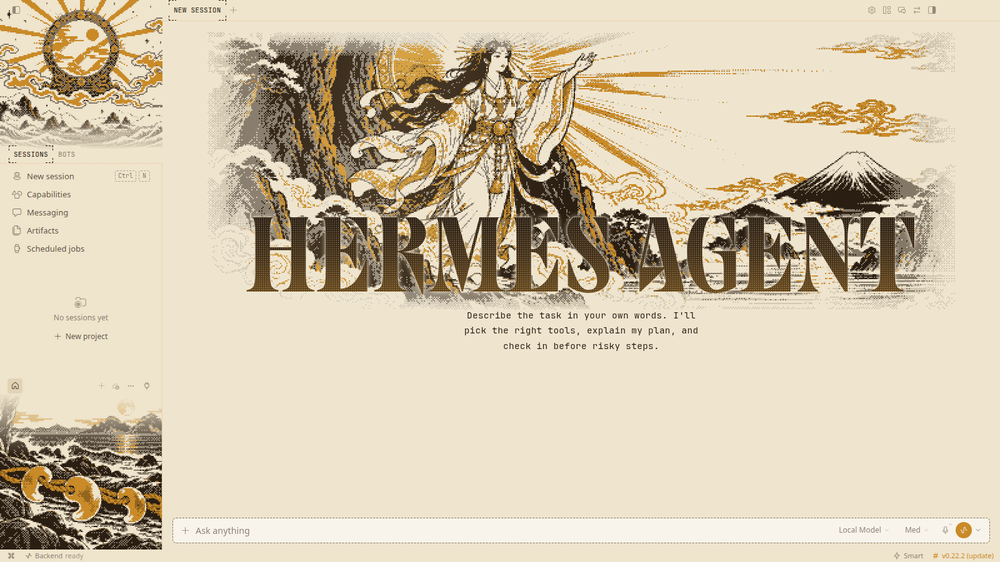
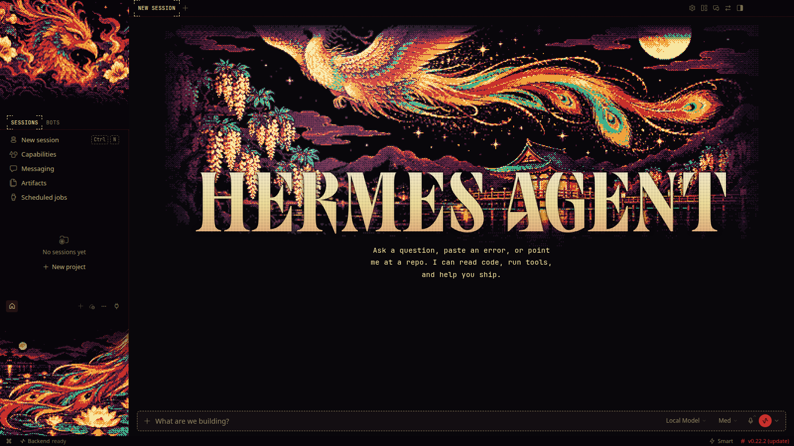
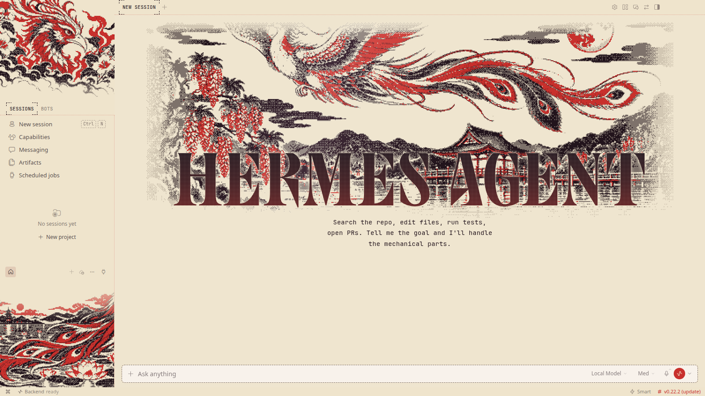
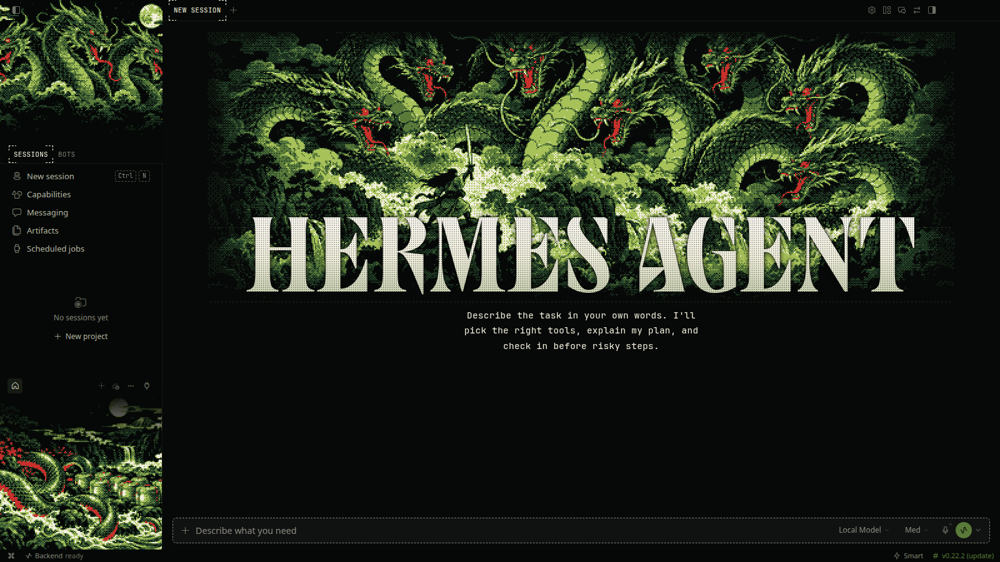
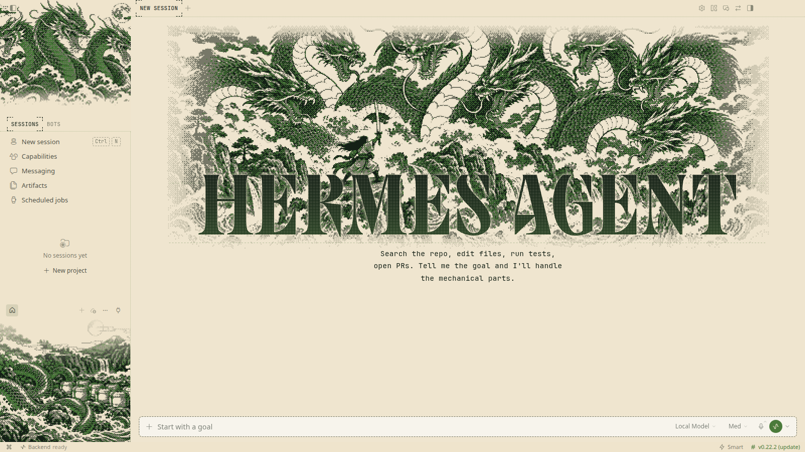
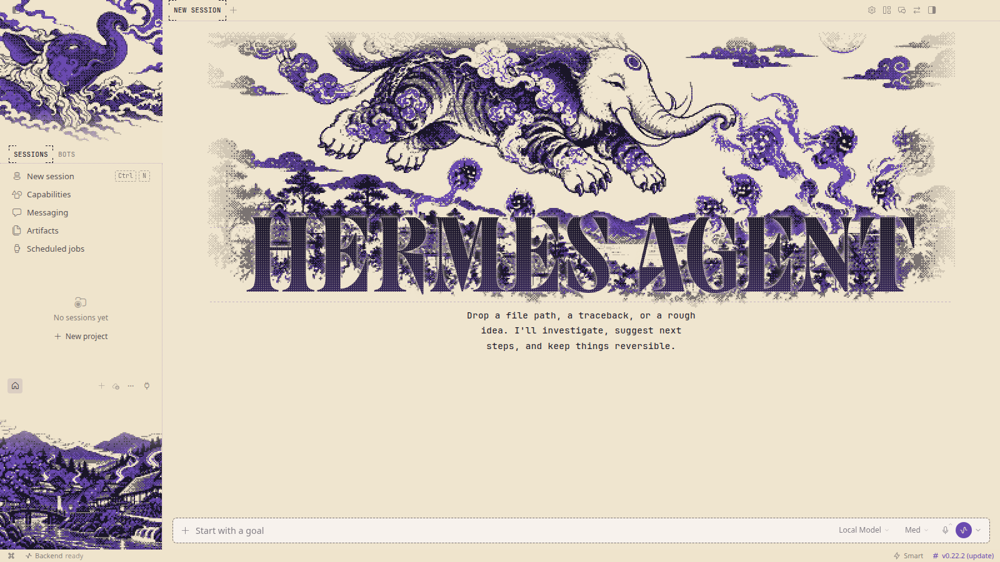

# Kami & Beasts

**Thunder and sun gods, the phoenix, the eight-headed serpent, the kirin and the dream eater.**

6 THEMES &nbsp;·&nbsp; <a href="../../../README.md#install">INSTALL</a> &nbsp;·&nbsp; <a href="../../../README.md#collections">ALL COLLECTIONS</a>

  

## Raijin & Fujin

`edo-raijin` · The thunder and wind gods

| Dark mode | Light mode |
|:---:|:---:|
|  |  |

## Amaterasu

`edo-amaterasu` · The sun goddess leaves her cave

| Dark mode | Light mode |
|:---:|:---:|
|  |  |

## Hoo Phoenix

`edo-hoo` · The phoenix over the lake pavilion

| Dark mode | Light mode |
|:---:|:---:|
|  |  |

## Orochi

`edo-orochi` · The eight-headed serpent

| Dark mode | Light mode |
|:---:|:---:|
|  |  |

## Kirin

`edo-kirin` · The kirin galloping on clouds

| Dark mode | Light mode |
|:---:|:---:|
|  |  |

## Baku

`edo-baku` · The dream eater over the village

| Dark mode | Light mode |
|:---:|:---:|
|  |  |
