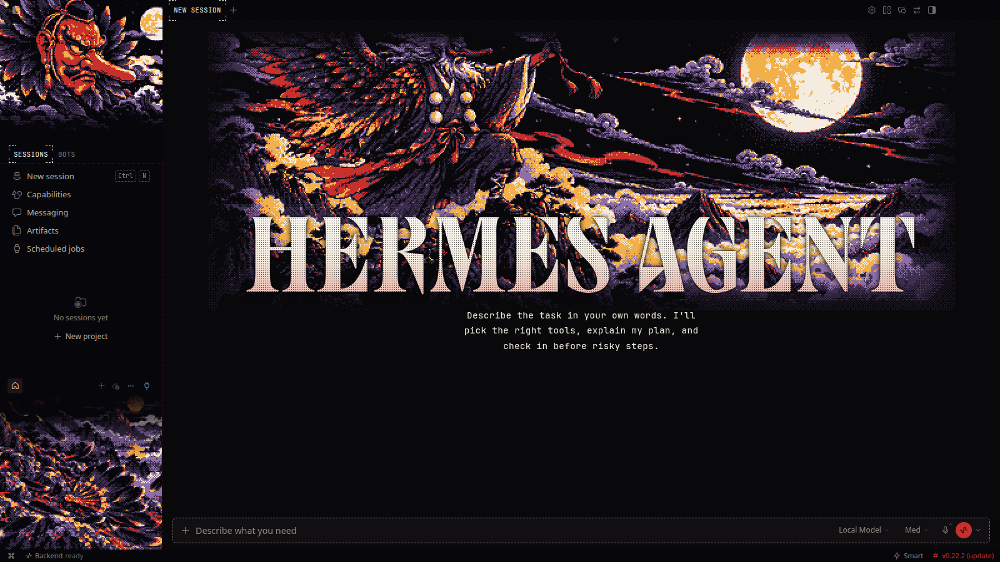
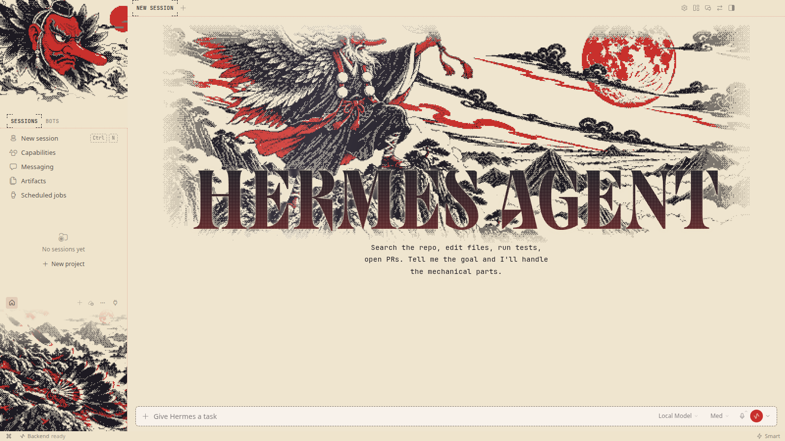
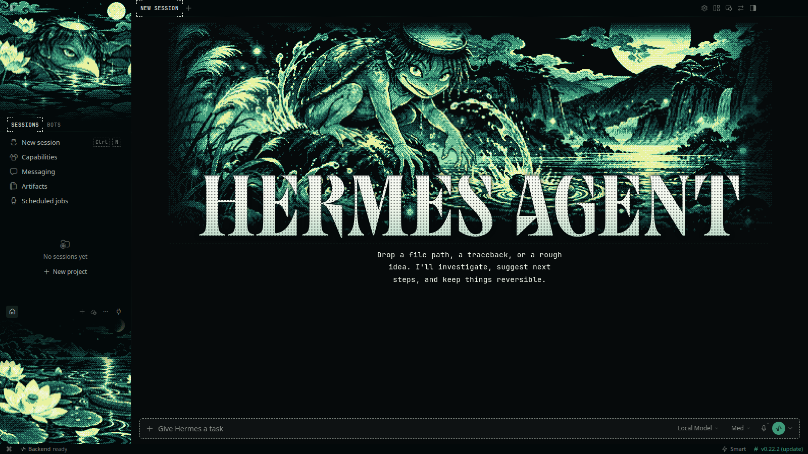
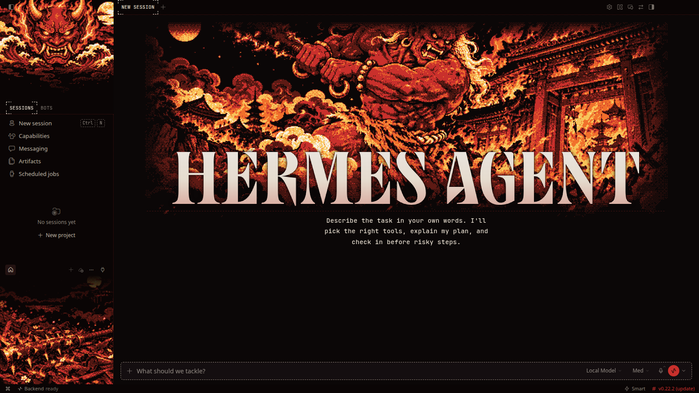
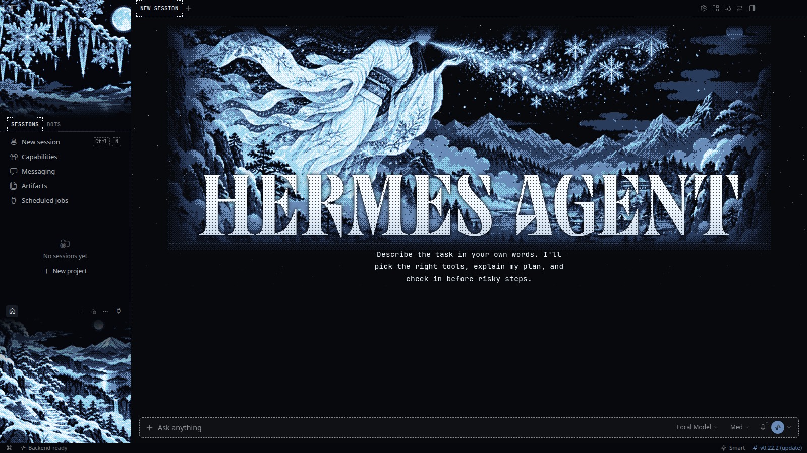

# Yokai Night Parade

**Goblins, river imps, demons and ghosts of Japanese folklore, glowing through the night.**

6 THEMES &nbsp;·&nbsp; <a href="../../../README.md#install">INSTALL</a> &nbsp;·&nbsp; <a href="../../../README.md#collections">ALL COLLECTIONS</a>

  

## Tengu

`edo-tengu` · A tengu above a sea of clouds

| Dark mode | Light mode |
|:---:|:---:|
|  |  |

## Kappa

`edo-kappa` · A kappa in the moonlit river

| Dark mode | Light mode |
|:---:|:---:|
|  |  |

## Oni

`edo-oni` · An oni at the burning gate

| Dark mode | Light mode |
|:---:|:---:|
|  |  |

## Nekomata

`edo-nekomata` · A two-tailed cat on the temple roof

| Dark mode | Light mode |
|:---:|:---:|
|  |  |

## Jorogumo

`edo-jorogumo` · A spider spirit's silver web

| Dark mode | Light mode |
|:---:|:---:|
|  |  |

## Yuki-onna

`edo-yukionna` · The snow woman in the blizzard

| Dark mode | Light mode |
|:---:|:---:|
|  |  |
