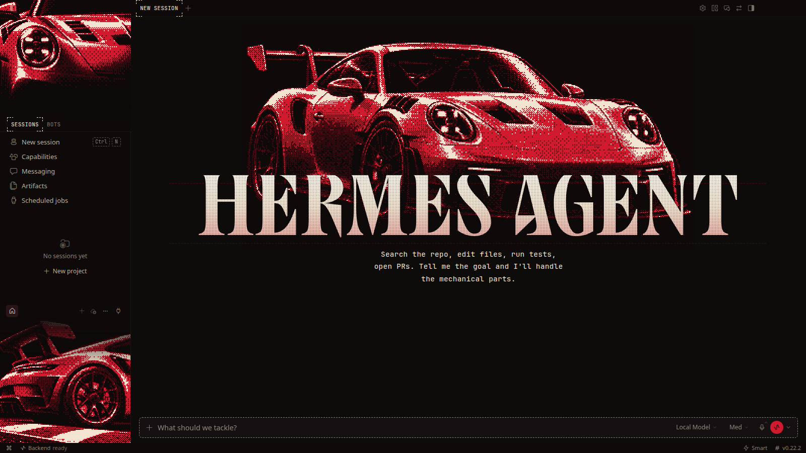
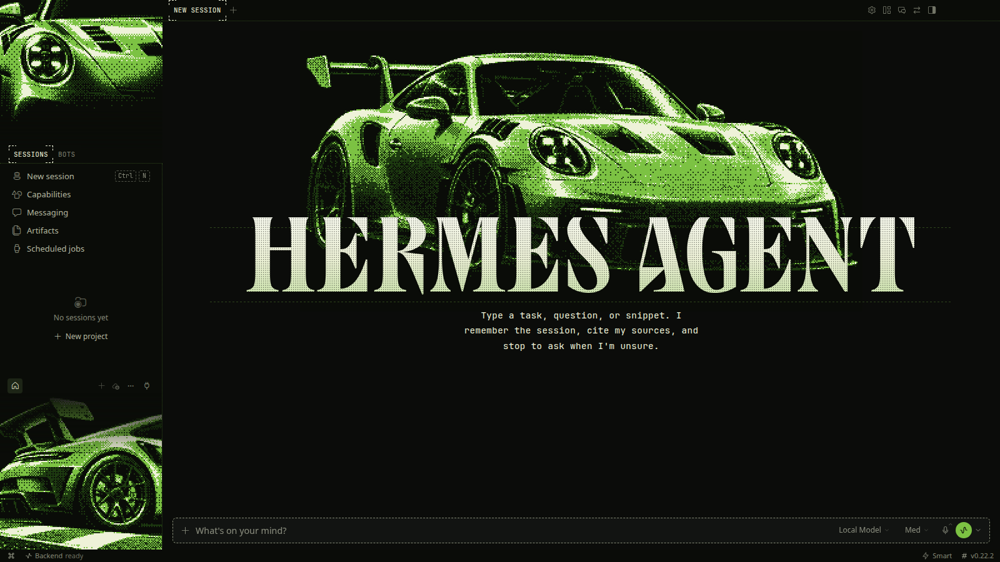
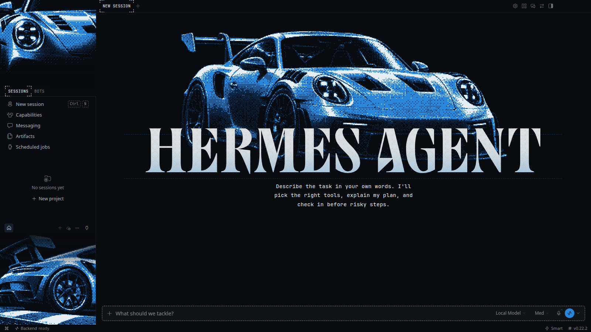
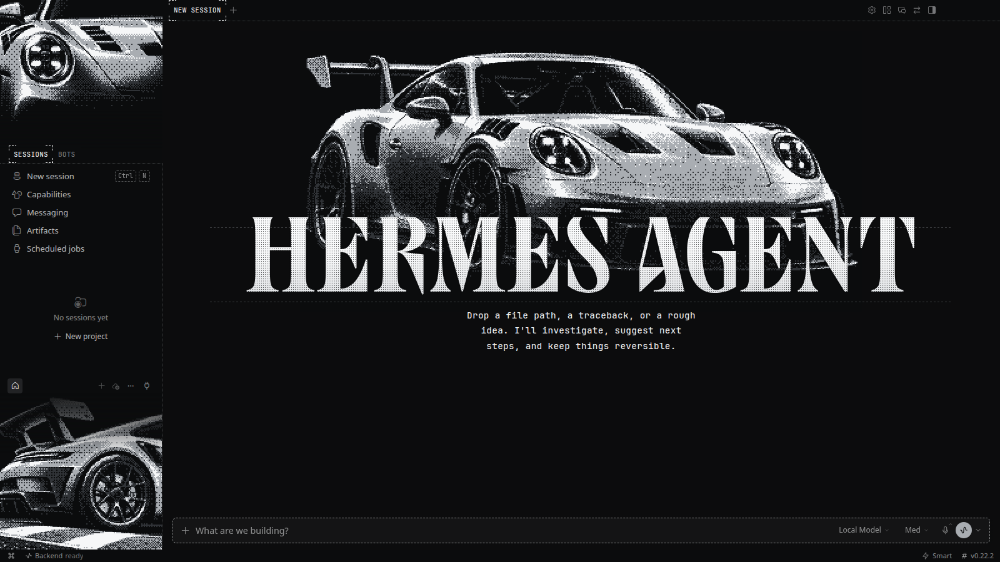

# GT3 RS

**Seven factory colours of the 992 GT3 RS. Same car, different paint.**

7 THEMES &nbsp;·&nbsp; <a href="../../README.md#install">INSTALL</a> &nbsp;·&nbsp; <a href="../../README.md#collections">ALL COLLECTIONS</a>

  

## Guards Red

`gt3rs-guards` · GT3 RS Guards Red, dithered pixels · [art](guards/art) · [full-size source](lava/raw)

## Lava Orange

`gt3rs-lava` · Lava orange track weapon in dithered pixels · [art](lava/art) · [full-size source](lava/raw)

## Racing Yellow

`gt3rs-yellow` · GT3 RS Racing Yellow, dithered pixels · [art](yellow/art) · [full-size source](lava/raw)

## Python Green

`gt3rs-python` · GT3 RS Python Green, dithered pixels · [art](python/art) · [full-size source](lava/raw)

## Shark Blue

`gt3rs-shark` · GT3 RS Shark Blue, dithered pixels · [art](shark/art) · [full-size source](lava/raw)

## Ruby Star

`gt3rs-ruby` · GT3 RS Ruby Star, dithered pixels · [art](ruby/art) · [full-size source](lava/raw)

## GT Silver

`gt3rs-silver` · GT3 RS GT Silver, dithered pixels · [art](silver/art) · [full-size source](lava/raw)

All the pixel art, side by side

 

