

# GT3 RS

**Seven factory colours of the 992 GT3 RS. Same car, different paint.**

7 THEMES &nbsp;·&nbsp; <a href="../../../README.md#install">INSTALL</a> &nbsp;·&nbsp; <a href="../../../README.md#collections">ALL COLLECTIONS</a>

  

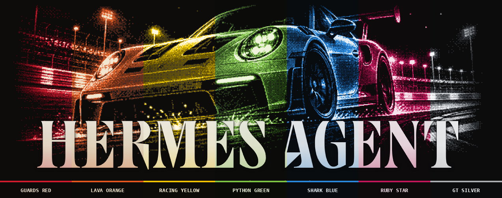

## Guards Red

`gt3rs-guards` · GT3 RS Guards Red, dithered pixels

| Dark mode | Light mode |
|:---:|:---:|
| 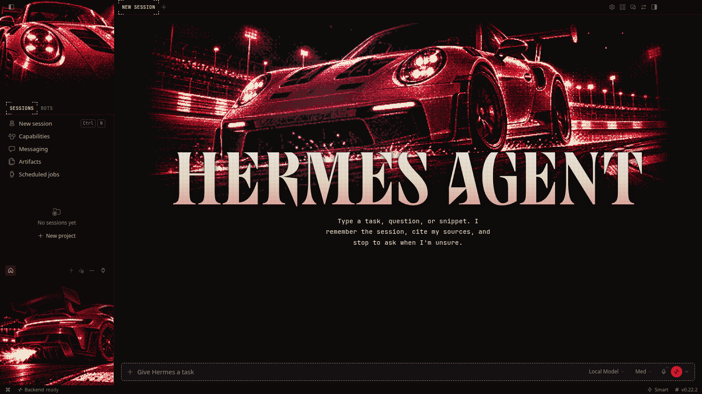 | 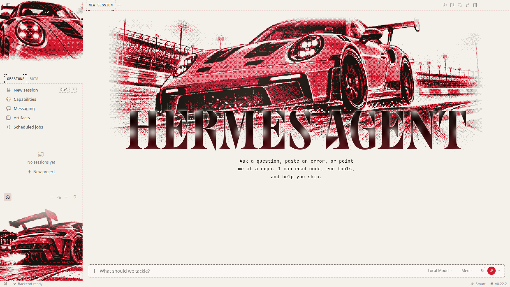 |

## Lava Orange

`gt3rs-lava` · Lava orange track weapon in dithered pixels

| Dark mode | Light mode |
|:---:|:---:|
| 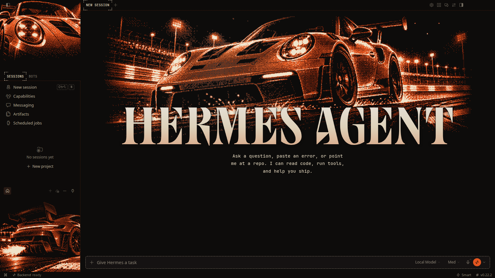 |  |

## Racing Yellow

`gt3rs-yellow` · GT3 RS Racing Yellow, dithered pixels

| Dark mode | Light mode |
|:---:|:---:|
| 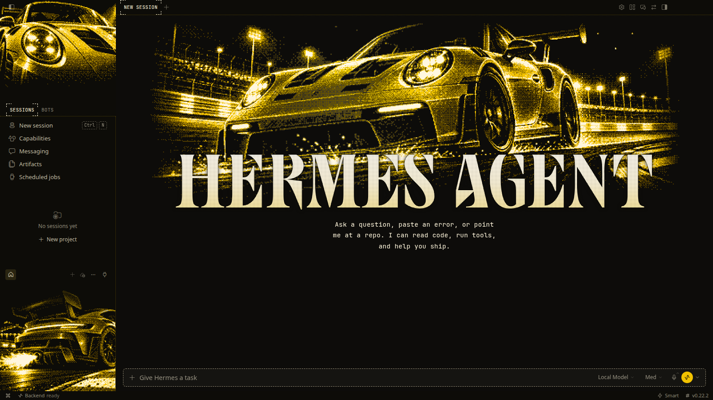 | 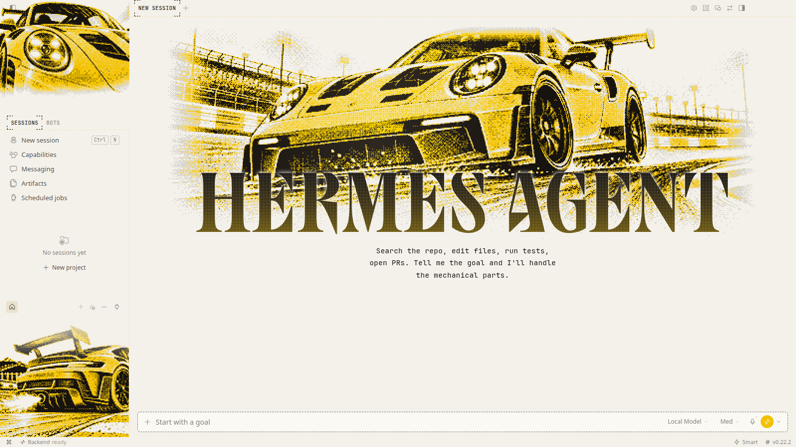 |

## Python Green

`gt3rs-python` · GT3 RS Python Green, dithered pixels

| Dark mode | Light mode |
|:---:|:---:|
| 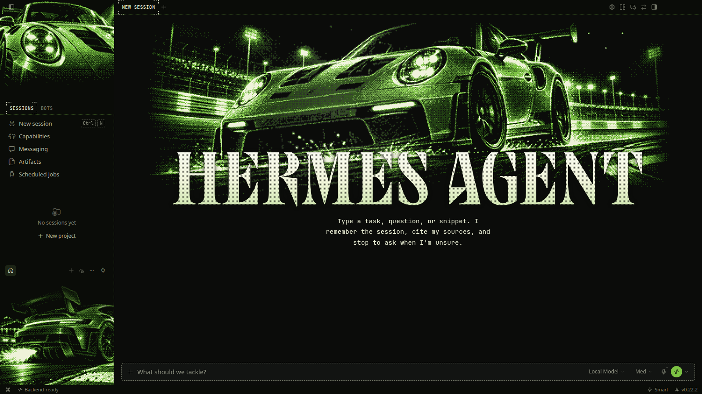 | 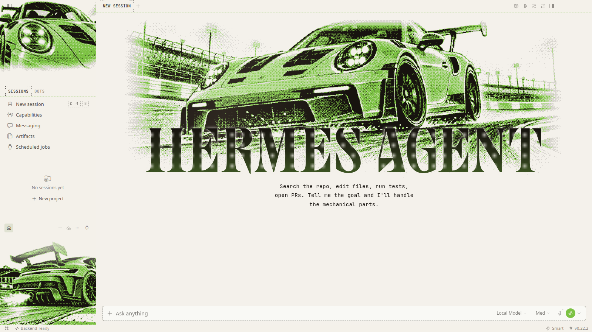 |

## Shark Blue

`gt3rs-shark` · GT3 RS Shark Blue, dithered pixels

| Dark mode | Light mode |
|:---:|:---:|
| 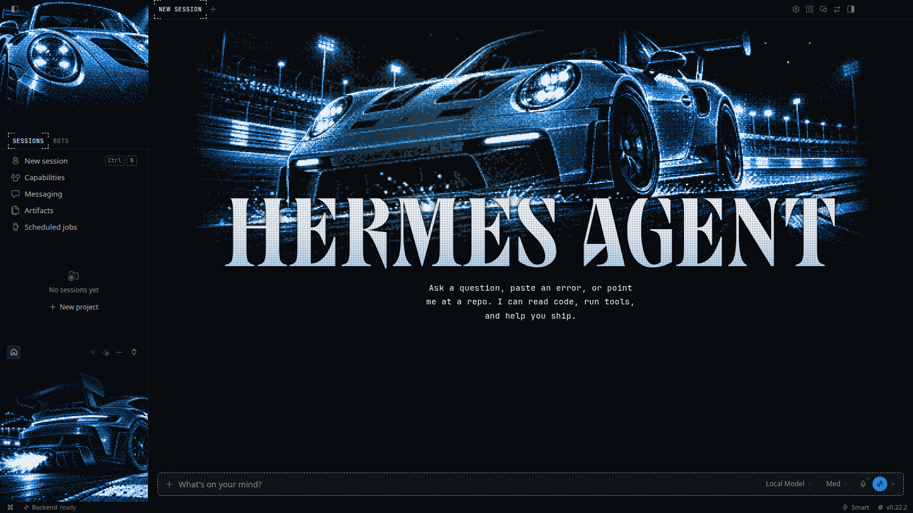 | 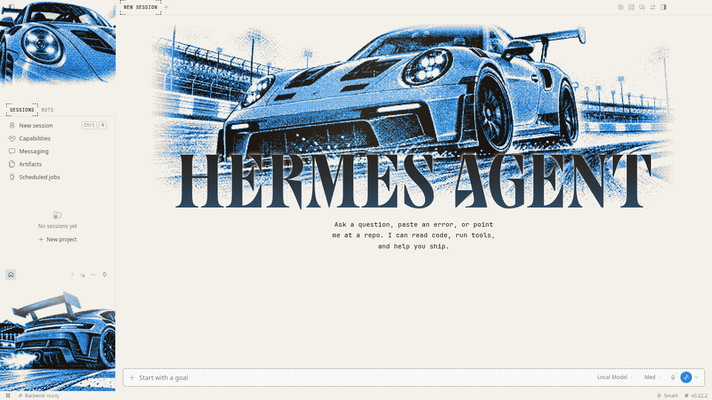 |

## Ruby Star

`gt3rs-ruby` · GT3 RS Ruby Star, dithered pixels

| Dark mode | Light mode |
|:---:|:---:|
| 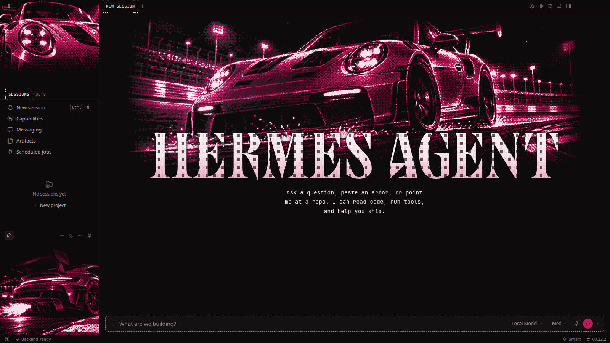 | 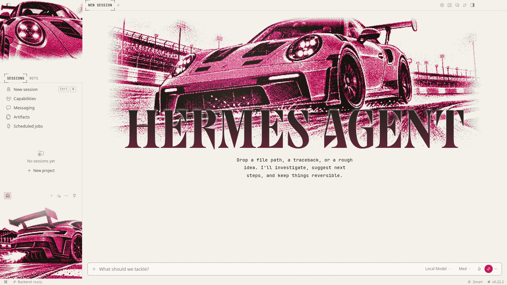 |

## GT Silver

`gt3rs-silver` · GT3 RS GT Silver, dithered pixels

| Dark mode | Light mode |
|:---:|:---:|
| 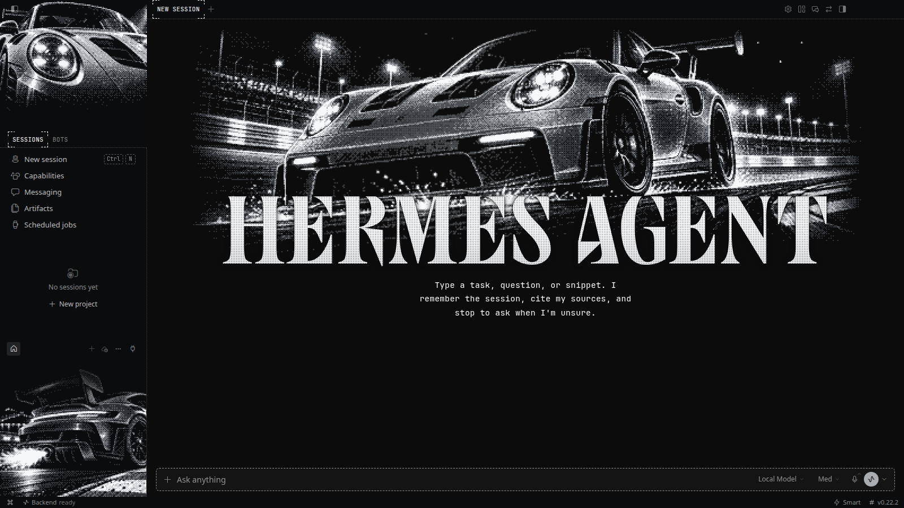 | 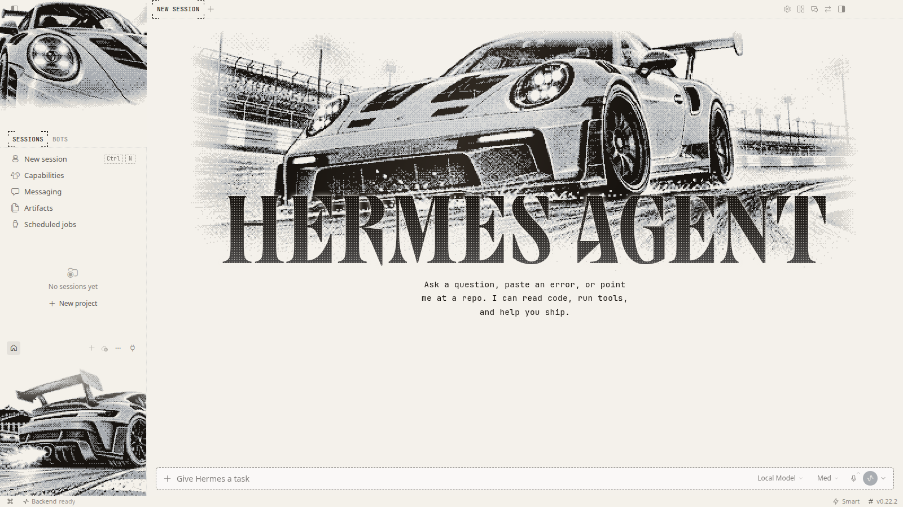 |
