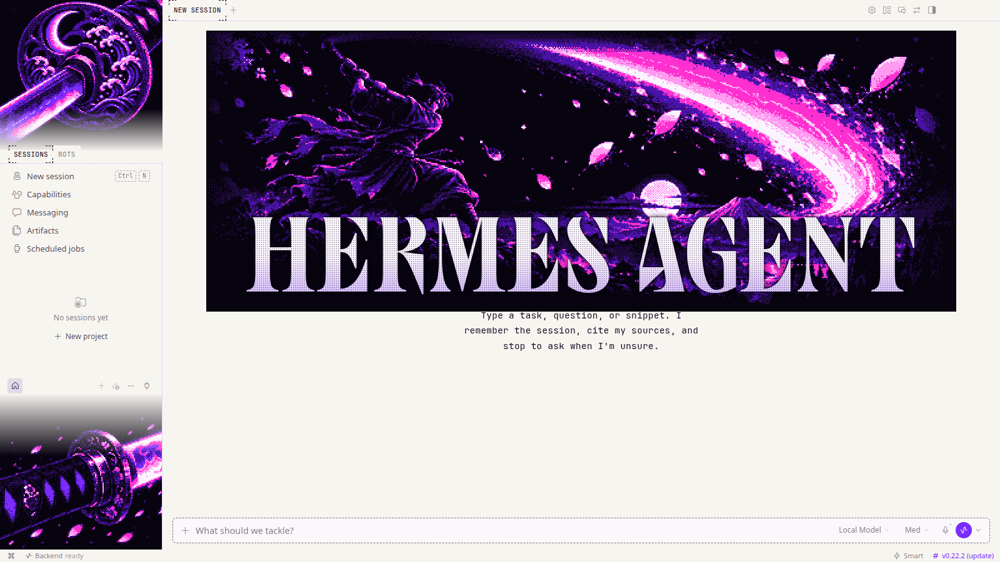
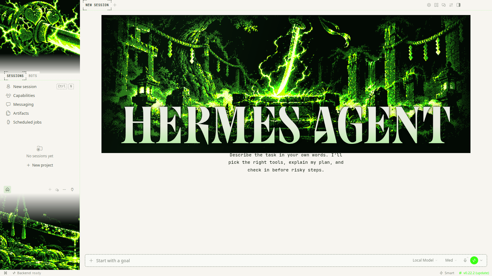
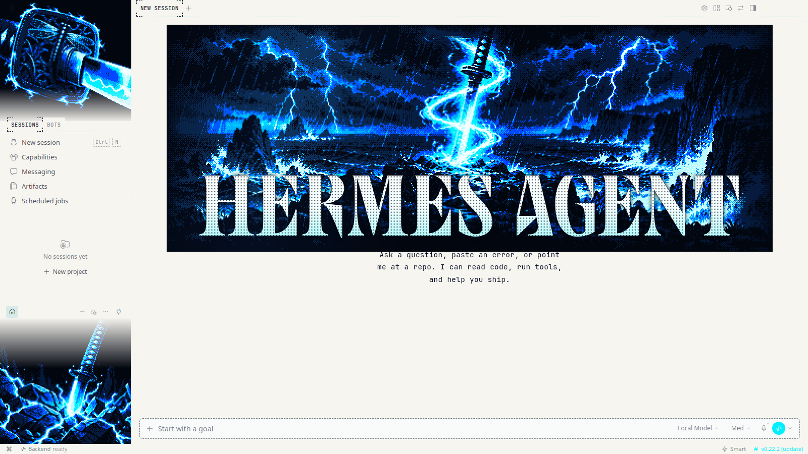
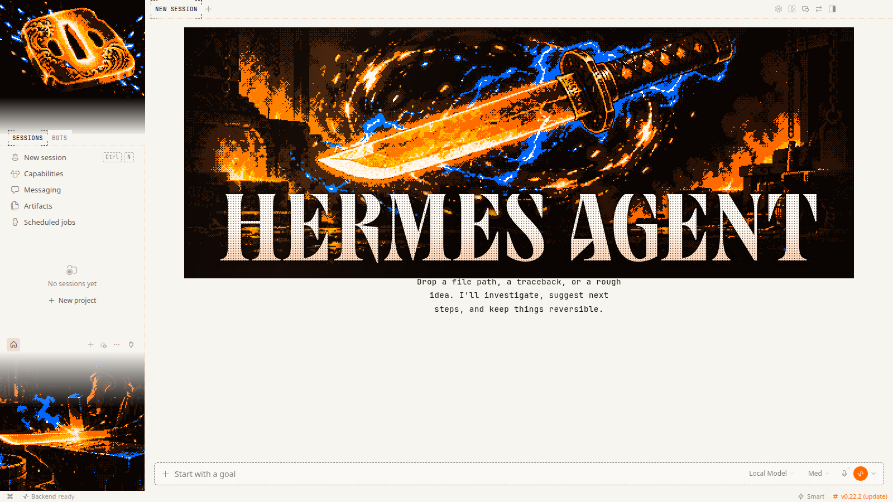
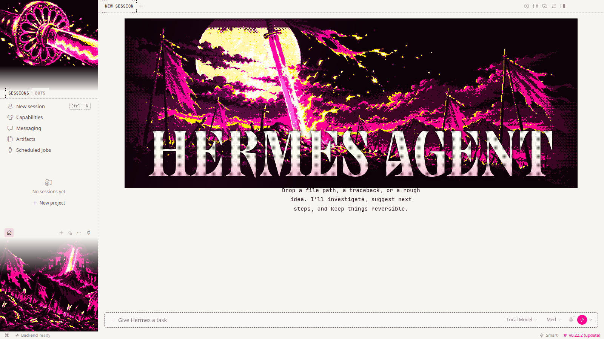
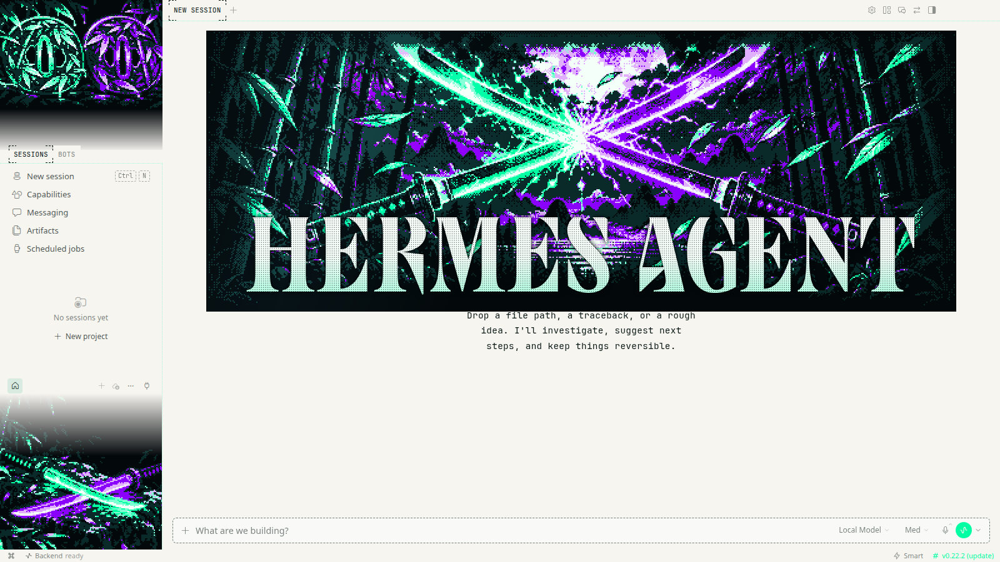

# Katana

**Six Japanese blades in neon colours never used before, glowing in the dark.**

6 THEMES &nbsp;·&nbsp; <a href="../../README.md#install">INSTALL</a> &nbsp;·&nbsp; <a href="../../README.md#collections">ALL COLLECTIONS</a>

  

## Uchigatana

`katana-uchigatana` · Ultraviolet steel mid-cut

| Dark mode | Light mode |
|:---:|:---:|
|  |  |

## Tachi

`katana-tachi` · An ancient tachi on the altar

| Dark mode | Light mode |
|:---:|:---:|
|  |  |

## Wakizashi

`katana-wakizashi` · Plasma storm around the blade

| Dark mode | Light mode |
|:---:|:---:|
|  |  |

## Tanto

`katana-tanto` · A molten tanto spinning in the dark

| Dark mode | Light mode |
|:---:|:---:|
|  |  |

## Odachi

`katana-odachi` · A giant blade on the ridge

| Dark mode | Light mode |
|:---:|:---:|
|  |  |

## Kodachi

`katana-kodachi` · Two kodachi crossed in neon

| Dark mode | Light mode |
|:---:|:---:|
|  |  |
