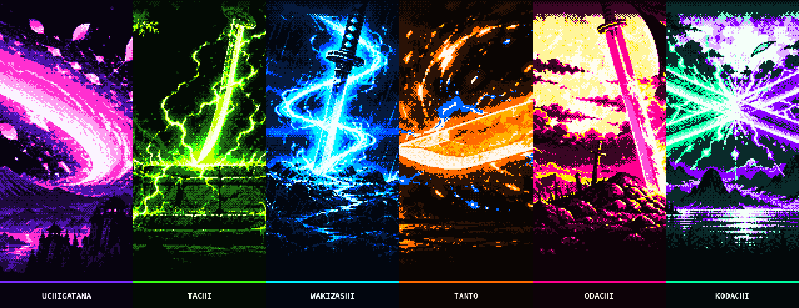
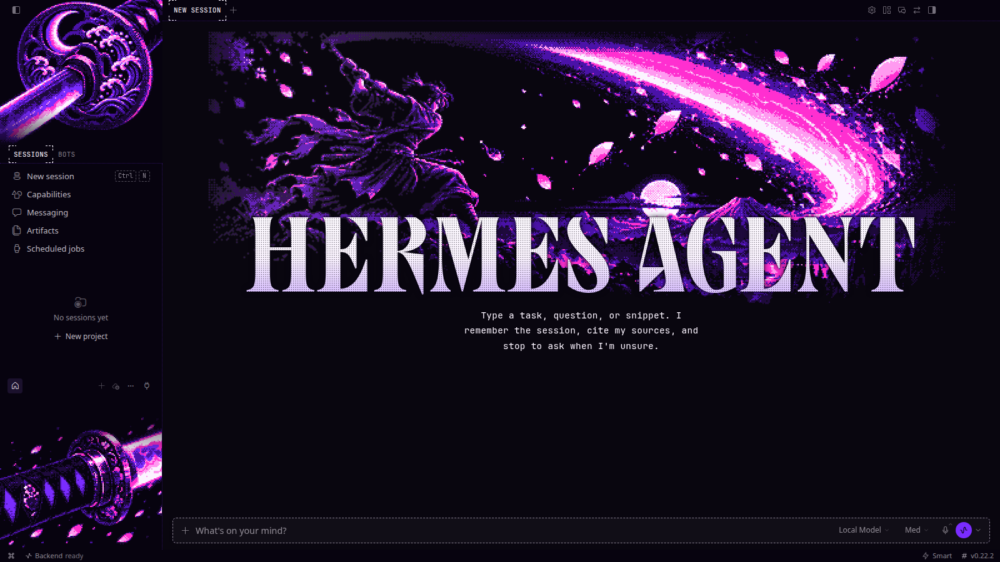
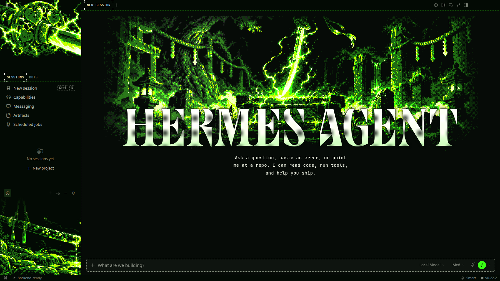
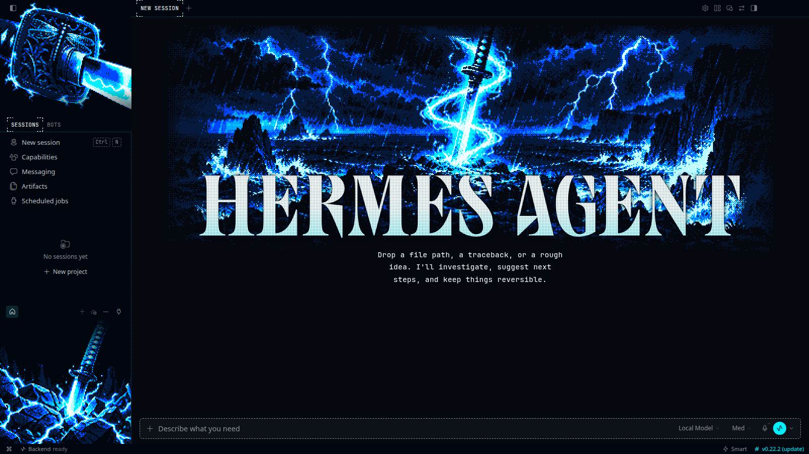
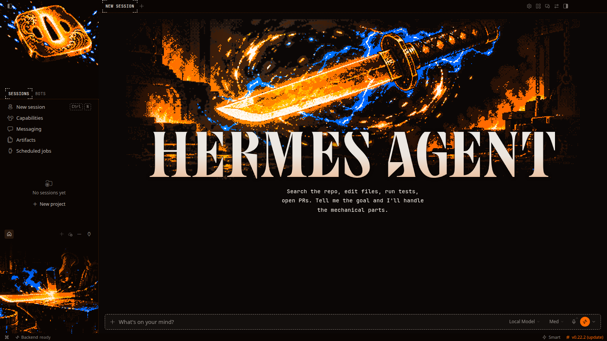
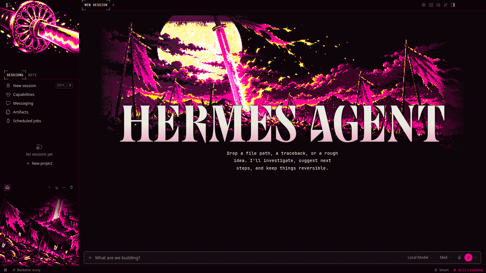
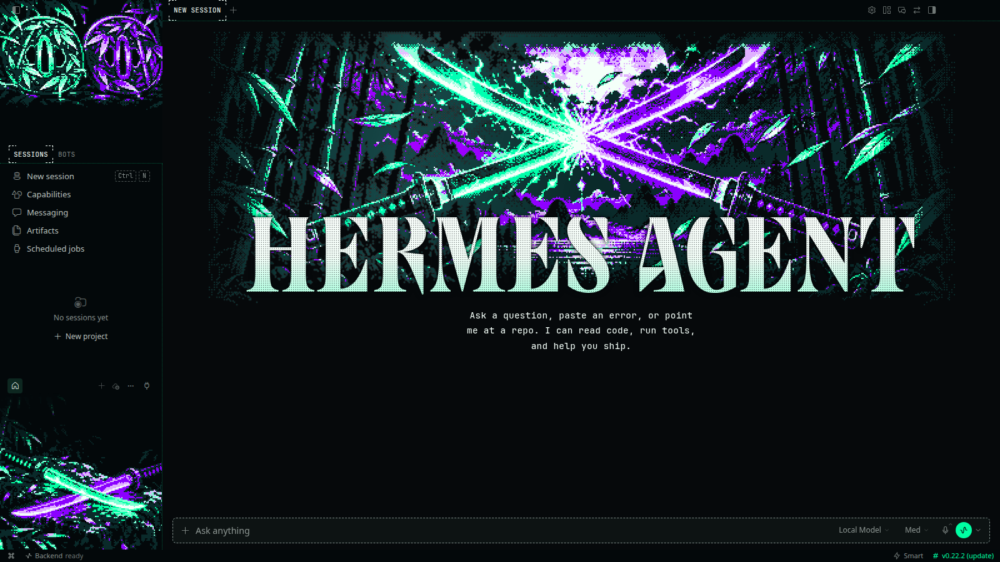

# Katana

**Six Japanese blades in neon colours never used before, glowing in the dark.**

6 THEMES &nbsp;·&nbsp; <a href="../../README.md#install">INSTALL</a> &nbsp;·&nbsp; <a href="../../README.md#collections">ALL COLLECTIONS</a>

  

## Uchigatana

`katana-uchigatana` · Ultraviolet steel mid-cut

## Tachi

`katana-tachi` · An ancient tachi on the altar

## Wakizashi

`katana-wakizashi` · Plasma storm around the blade

## Tanto

`katana-tanto` · A molten tanto spinning in the dark

## Odachi

`katana-odachi` · A giant blade on the ridge

## Kodachi

`katana-kodachi` · Two kodachi crossed in neon

