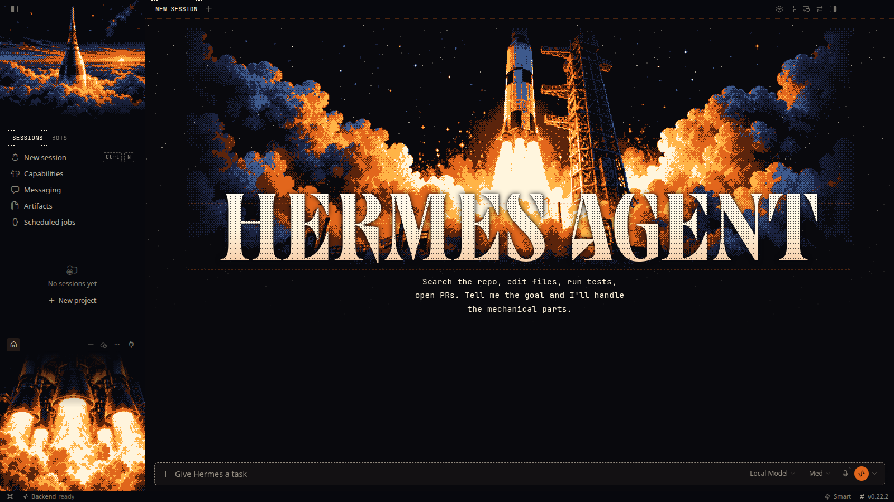
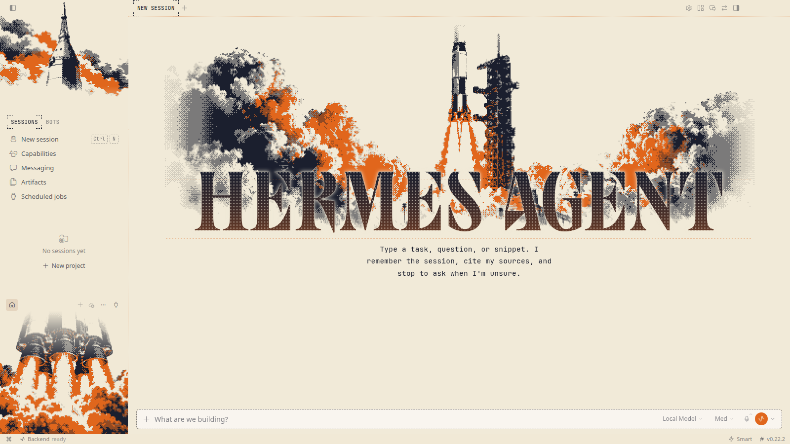
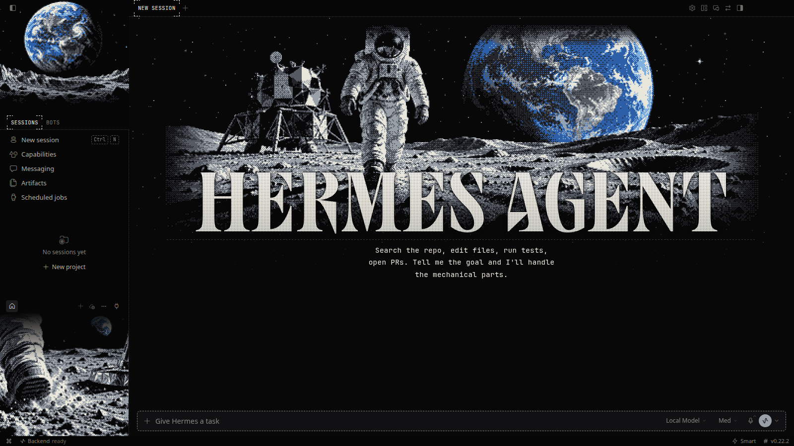
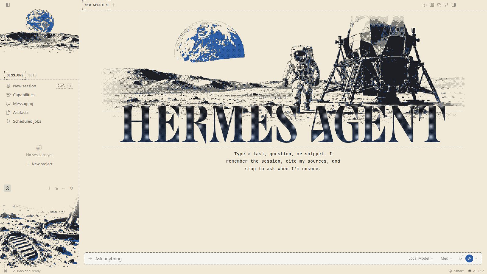
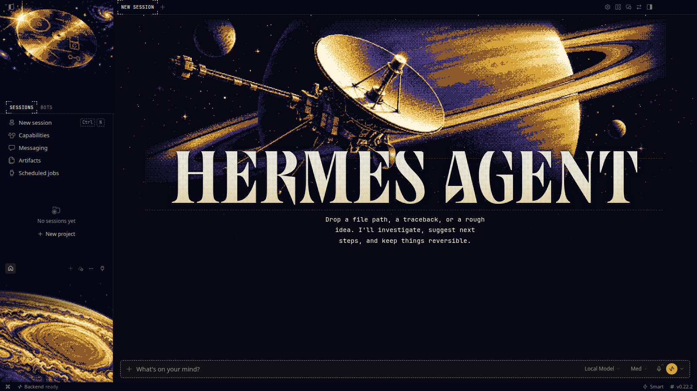
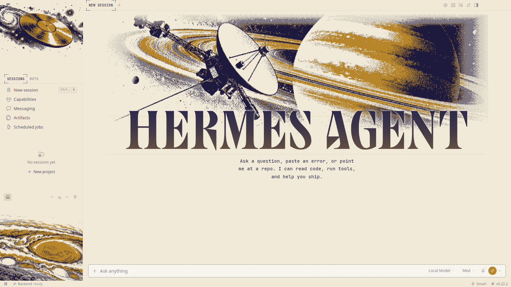
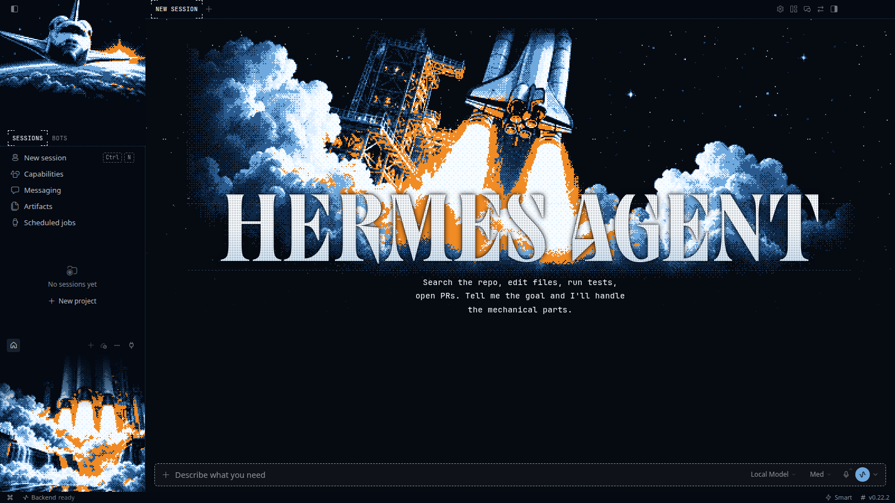
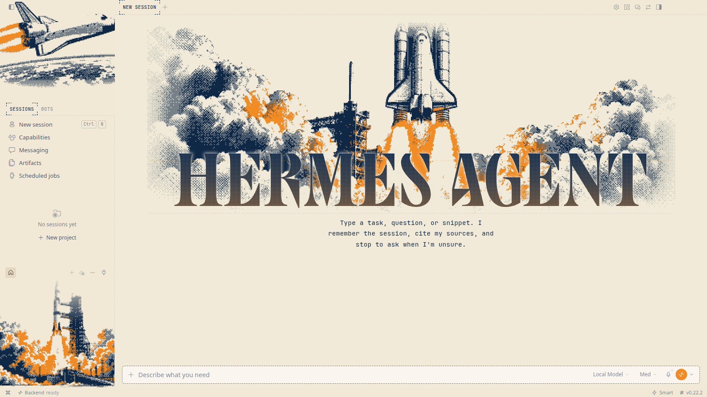
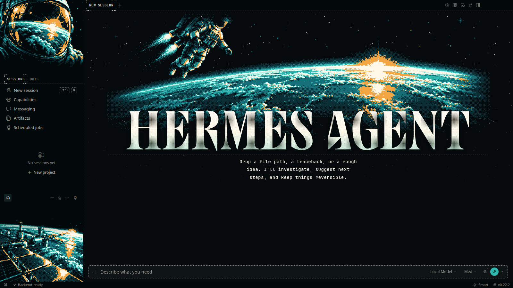
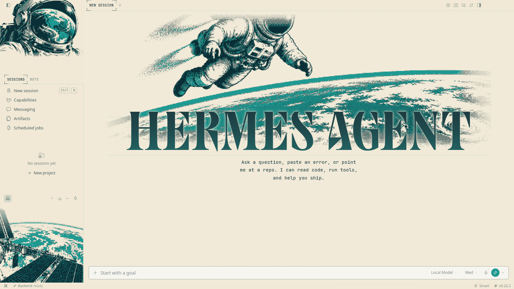

# Space Race

**Five moments of the space age, from the Saturn V to the spacewalk.**

5 THEMES &nbsp;·&nbsp; <a href="../../README.md#install">INSTALL</a> &nbsp;·&nbsp; <a href="../../README.md#collections">ALL COLLECTIONS</a>

  

## Saturn V

`space-saturn` · The moon rocket clearing the tower · [art](saturn/art) · [full-size source](saturn/raw)

| Dark mode | Light mode |
|:---:|:---:|
|  |  |

## Apollo 11

`space-apollo` · Footprints on the Sea of Tranquility · [art](apollo/art) · [full-size source](apollo/raw)

| Dark mode | Light mode |
|:---:|:---:|
|  |  |

## Voyager

`space-voyager` · Golden record, outbound since 1977 · [art](voyager/art) · [full-size source](voyager/raw)

| Dark mode | Light mode |
|:---:|:---:|
|  |  |

## Space Shuttle

`space-shuttle` · Payload bay open over the blue marble · [art](shuttle/art) · [full-size source](shuttle/raw)

| Dark mode | Light mode |
|:---:|:---:|
|  |  |

## Spacewalk

`space-eva` · Tethered, floating, two hundred miles up · [art](eva/art) · [full-size source](eva/raw)

| Dark mode | Light mode |
|:---:|:---:|
|  |  |

All the pixel art, side by side

 

