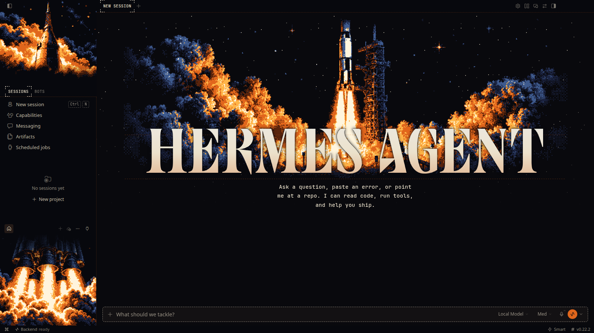
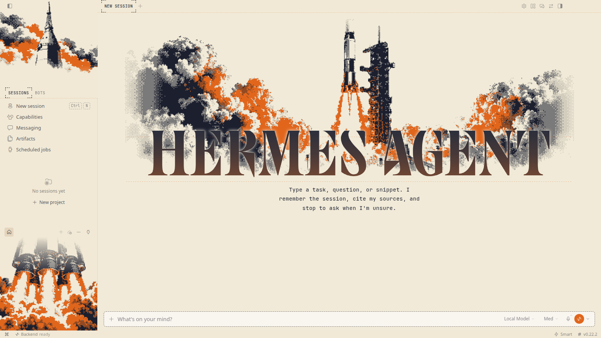
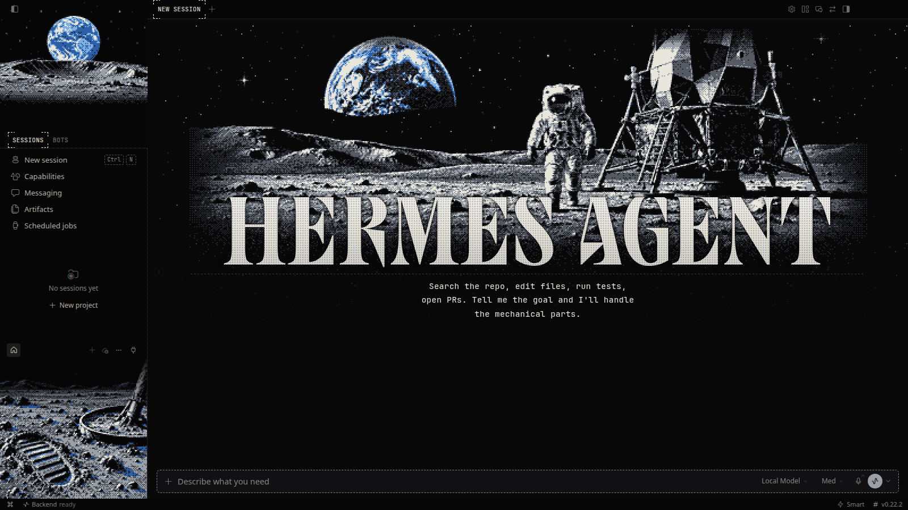
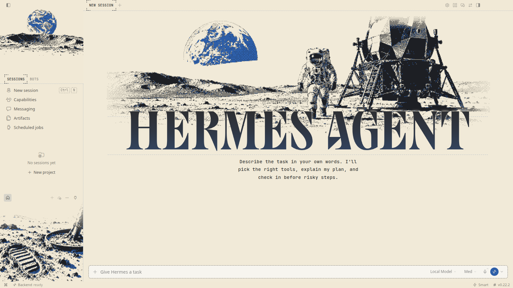
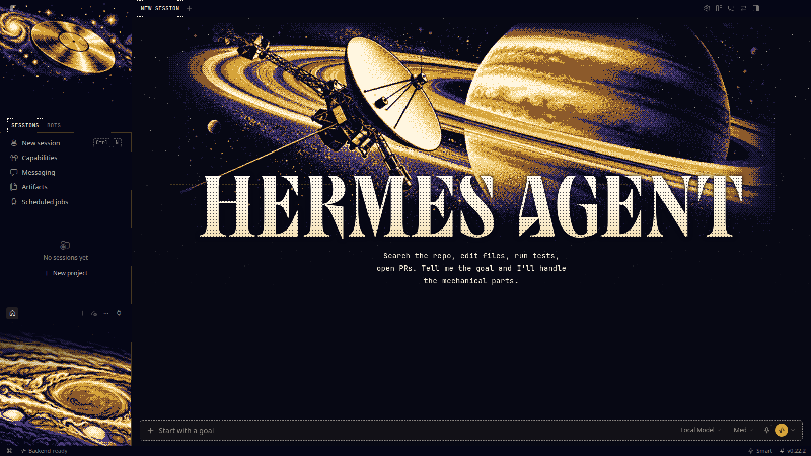
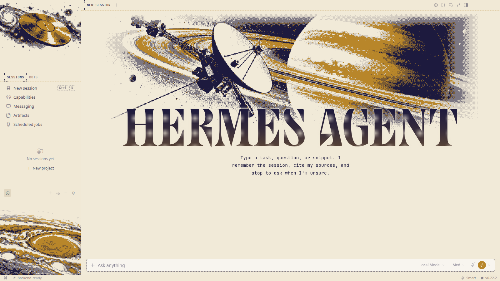
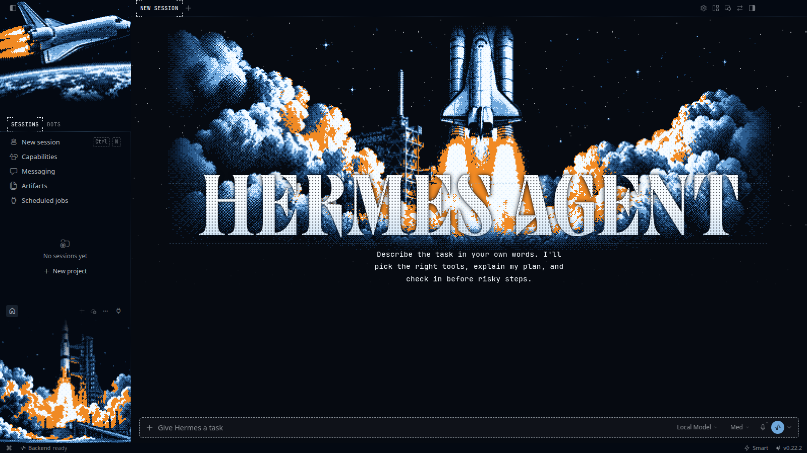
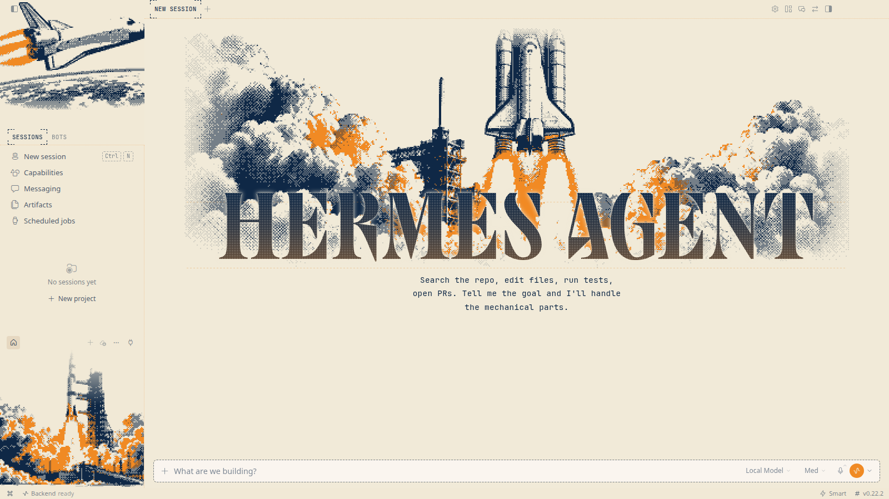
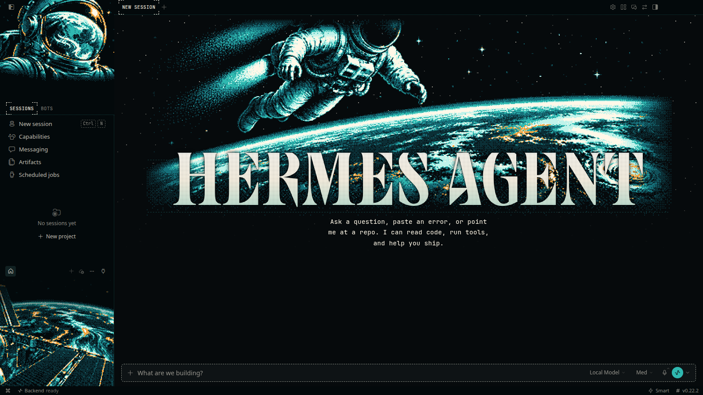
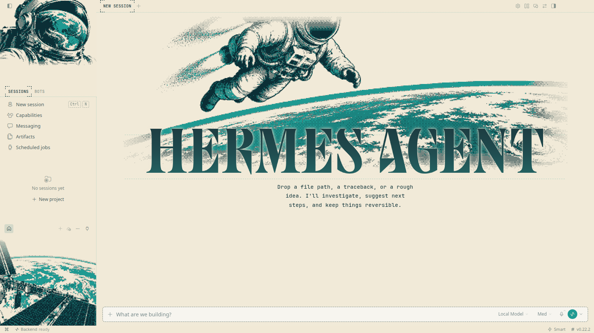

# Moonshot

**The space age as a 1960s print: the same five missions, drawn again.**

5 THEMES &nbsp;·&nbsp; <a href="../../../README.md#install">INSTALL</a> &nbsp;·&nbsp; <a href="../../../README.md#collections">ALL COLLECTIONS</a>

  

## Saturn V

`moonshot-saturn` · The moon rocket clearing the tower

| Dark mode | Light mode |
|:---:|:---:|
|  |  |

## Apollo 11

`moonshot-apollo` · Footprints on the Sea of Tranquility

| Dark mode | Light mode |
|:---:|:---:|
|  |  |

## Voyager

`moonshot-voyager` · Golden record, outbound since 1977

| Dark mode | Light mode |
|:---:|:---:|
|  |  |

## Space Shuttle

`moonshot-shuttle` · Payload bay open over the blue marble

| Dark mode | Light mode |
|:---:|:---:|
|  |  |

## Spacewalk

`moonshot-eva` · Tethered, floating, two hundred miles up

| Dark mode | Light mode |
|:---:|:---:|
|  |  |
